```{r setup, include=FALSE}
library(tufte)
library(rnaturalearth)
library(rnaturalearthhires)
library(sf)
library(ggplot2)
library(viridis)
library(patchwork)
library(elevatr)
library(terra)
library(osmdata)
library(leaflet)
library(tidyverse)
library(pipeR)
library(rlist)
library(sf)
library(janitor)
library(knitr)
library(kableExtra)
library(dodgr)
library(magick)
library(osmplotr)
library(magrittr)
library(scales)
library(cowplot)

# invalidate cache when the tufte version changes
knitr::opts_chunk$set(cache.extra = packageVersion('tufte'))
options(htmltools.dir.version = FALSE)
knitr::knit_hooks$set(crop = knitr::hook_pdfcrop)

```

::: {.fullwidth}
# Abstract
Railway stations, 
bus stops, 
post offices and similar facilities 
can often provide an important focus for communities, 
including as a central hub for the movement of people and goods, 
and places of social interaction. 
Recent research directions have: emphasised 
the ‘Place’ function of road 
(and other transport) 
facilities as a vital 
and additional dimension, 
alongside the more traditional focus 
of transport systems 
for through movement 
and access 
to adjoining land uses; 
introduced the concept of shared electric mobility hubs, 
which seek to provide a central location 
at which travelers 
and nearby residents might have access 
to electric cars, 
e-cargo bikes, 
e-bikes 
or other modes that might support more sustainable travel choices, 
especially in contexts where the provision of high frequency transit services may be challenging 
(e.g. regional towns, rural communities, low-density suburbs); and
suggested the adoption of person-centric design approaches such as co-design, from industrial design and related fields, 
by researchers and practitioners in transport. 
However, it is unclear what form such shared electric mobility hubs should take, 
and how such industrial design methodologies might be used in their development.  
The extent to which the co-location of other facilities
(e.g. library, café, bus stop, community house) 
might enhance usage, 
safety and security 
(c.f. Jane Jacob's "eyes on the street")
and local communities, 
or how new tools for crime prevention recent developed in the context of public transport might be adapted to mobility hubs.  

Four shared e-mobility hubs have recently been implemented in 
Letterkenny, Galway, Waterford and the suburbs of Dublin. 
These include e-bikes, 
e-cargo bikes, 
and shared electric cars 
as part of the ‘base’ offering, 
as well as *power infrastructure* to support recharging of these vehicles, 
*and other (future) uses*. 
These represent a considerable capital investment 
and potential for improved mobility for these locations, 
but also the potential to 
support individual and community needs 
and grow the 'mobility offer' 
through supporting programs, 

However, it is unclear 
what additional mobility, 
community-focused, 
commercial 
or other offerings might be desired by 
communities, 
or might help to support the use of shared e-mobility hub facilities 
to improve transport sustatinability. 
Perhaps such hubs can help to make existing programs 
(e.g. meals-on-wheels, council officer trips, inter-library loans)
more sustainable? 
Or perhaps such hubs might become places in and of themselves, 
with a similar mix of services and facilities as might be found in a railway station. 

This paper reports the findings from co-design creative workshops 
held in Letterkenny, Galway, Waterford and Dublin 
to explore community attitudes, needs and ideas 
as to how the ‘base’ shared e-mobility hub might be leveraged 
and enhanced so as to better meet each community’s transport and other needs. 
The cross-case comparisons 
reported in this paper 
might provide policy-makers, 
practitioners and researchers 
further insights into the types of offerings that might be provided 
at shared e-mobility hubs and other transport facilities 
in a variety of contexts (small town, secondary town centre, suburban locations etc.) 
so as to enhance sustainable mobility and community outcomes 
in future such transport facility developments.

:::

# Introduction

Current understandings of how to design and implement transit stations and stops, roadways and streets, and other elements of the public realm have developed over long periods of time.  @Green:1995aa, @Beanland:2024aa and many others discuss some of the more formal processes and their outputs, while @Engwicht:1999aa, @Lydon:2012aa, @Lydon:2015aa and others outline street reclaiming, tactical urbanism and similar (and often citizen-led) efforts to reorganise public roads. As well, while road and rail systems and practices are well established, shifts of emphasis and technology change are inevitably leading to new problems, the need for new solutions, or just different ways of doing things. Examples include: the introduction of new vehicle and stop types that allow for level-boarding access to transit, which has been driven by legislative change related to human rights, discrimination and accessibility [@Currie:2006ad]; the development of electric vehicles, demand responsive transit systems, the concepts related to Mobility as a Service (MaaS), autonomous vehicles, and changes due to the modern proliferation of mobile communications technologies, shared and micromobility systems and many more (see @Nelson:2025aa and others).  

Shared electric mobility hubs are one of these many recent developments, which necessitate the development and refinement of designs and practices to transition from an initial concept to more established and relatively easily implementable products. The initial concept is relatively simple, and responds to many of the problems that have emerged with dockless electric bike and scooter systems. These include poor user behaviour with respect to parking, a need for workers to reposition vehicles and replace batteries, and the risk of fires when battery recharging is done using non-bespoke or appropriately desgined facilities (e.g. in gig-workers' houses)(see @Zhang:2022aa, @Meigs:2023aa, @Ferguson:2025aa and others). Instead, a shared electric mobility hub provides dedicated parking, electrical connections and other facilitates for electric bikes, cars or other vehicles, which are made available on an as-needed and shared basis to the general public. Charging occurs at the hub, while hires involve both outward and return journeys rather than point-to-point trips. 


```{r maps, include=FALSE, echo=FALSE, fig.margin = TRUE, fig.cap = "ROBUST hub locations within the Republic of Ireland", crop = TRUE}
map1 <- rnaturalearth::ne_states("Ireland", returnclass = "sf")
p1 <- ggplot(map1) + geom_sf() 

hub_location <- list(
  letterkenny = tibble(lat=54.95151900289267, lon =-7.734405435672215, name = "Letterkenny"), 
  galway = tibble(lat = 53.277326344086504, lon = -9.073269666553948, name = "Galway"), 
  waterford = tibble(lat = 52.2599339, lon = -7.1170565, name = "Waterford"),
  dundrum = tibble(lat = 53.288029794549054, lon = -6.241222689308968, name = "Dublin"))


ggsave(file="graphics/map.png", plot = p1 + 
  geom_point(data = do.call(rbind.data.frame, hub_location), aes(x = lon, y = lat)) + 
  ggrepel::geom_label_repel(data = do.call(rbind.data.frame, hub_location), aes(x = lon, y = lat, label=name), hjust=1.05, vjust=1.05, size = 5.0) + 
  theme(
        axis.title.x  = element_blank(), 
        axis.title.y  = element_blank() 
       ), 
  height = 7, 
  width = 7, 
  units = "in"
) 

```

```{r plot_maps, include=TRUE, echo=FALSE, fig.margin = TRUE, fig.cap = "ROBUST hub locations within the Republic of Ireland", crop = TRUE}
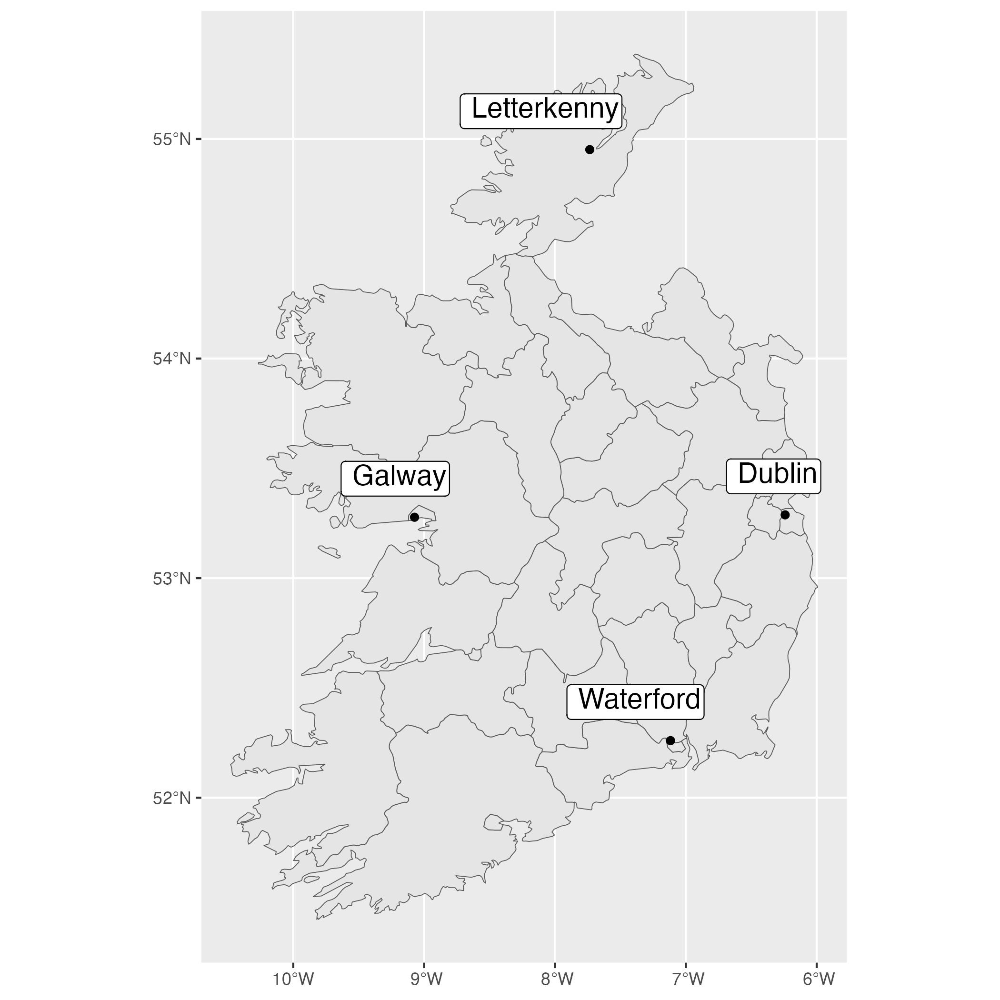 

```


```{r plot_bikes_photo, include=TRUE, echo=FALSE, fig.margin = TRUE, fig.cap = "Letterkenny ROBUST hub: electric bikes", crop = TRUE}
knitr::include_graphics("graphics/letterkenny_bikes.png") 

```

```{r plot_cars_photo, include=TRUE, echo=FALSE, fig.margin = TRUE, fig.cap = "Letterkenny ROBUST hub: cars and charger", crop = TRUE}
knitr::include_graphics("graphics/letterkenny_cars.png") 

```


Such hubs, however, have yet to be widely deployed. There is only limited research and practitioner experience about how they might best be designed and implemented under real-world conditions and to best . The research reported in this paper, therefore, seeks to improve understandings about how to design mobility hubs and their surrounds to encourage usage, help towards meeting community needs, and improve environmental, social and economic outcomes. This is achieved through a case study approach, based around the four hubs implemented as part of the Electric shaRed mOBility hUbS Trial (ROBUST) project currently underway in the Republic of Ireland. ROBUST involves four sites, in Galway, Letterkenny, Waterford and Dublin (Figure \ref{fig:plot_maps}), where 'initial offers' of four electric bikes, one electric cargo bike and two electric cars (Figures \ref{fig:plot_bikes_photo} and \ref{fig:plot_cars_photo}) were implemented during 2025 and 2026. 
These 'initial offers' were largely designed and implemented by engineers, planners and other technical specialists to meet the basic needs and functionality requirements associated with parking and charging the seven vehicles at each site. Design approval processes with local authorities, to meet safety requirements and to respond to other technical necessities were undertaken, in part relying on those developed for the implementation of shared electric car, docked bike and similar technologies on an individual vehicle or mode basis (i.e. not as part of a 'mobility hub'). There are, however, a wide range of research questions related to what users might want, need, expect or otherwise desire from a 'mobility hub', and the extent to which these are fulfilled by the 'initial offers', as implemented, is unclear.  

Industrial design as a field often deals with the manufacturing of consumer products, specialised devices or similar. While transport applications may have tended more towards the design and manufacturing of private motor cars, @Coxon:2018aa, @Coxon:2021ab and @Coxon:2021aa insights into how industrial design and its methodologies might help to inform the research related to the design, implementation and operation of transit and transport systems more generally. This paper, therefore, describes efforts to put such methods into research activity related to user-centric and co-design approaches to shared electricity mobility hub design and implementation, through the context of the ROBUST case study sites.  Findings from these activities may provide insights for researchers and practitioners as to how mobility hubs might be designed and implemented to better met the needs of users and communities, and help towards responding to the current pressing need to move towards more sustainable transportation systems. 

The next section of this paper describes the research background and context for this study. Methods used during the case studies are then outlined,followed by presentation of results. These are discussed prior to a brief conclusion, which includes the identification of directions for future research.   


# Research background

A bibliometric mapping analysis and review of literature relevant to the ROBUST project is reported elsewhere in @Reynolds:0aaa, but in general describes the various beginnings of the 'mobility hub' concept.  These include use of the term in the Greater Toronto and Hamilton Area (GTHA) in Ontario, Canada, related to the Metrolinx regional planning authorities 'Big Move' plan [@Salsberg:2010aa, @Engel-Yan:2012aa, @Engel-Yan:2014aa]. This envisages 'mobility hubs' as encompassing areas within and around regionally significant transit stations and stops, where planning and infrastructure interventions would be used to facilitate inter-modal transfers, Transit Oriented Development (TOD) and other elements. Such concepts relate back to much previous research into TOD, including with respect to the "3Ds: Density, Diversity, and Design"  [@Cervero:1997aa], plus "Destination, Distance, and Demand" in @Ogra:2014aa, but also to slightly earlier developments in Europe including integration of trams and trains at a station in Augsburg, Germany [@Beyer:2005aa], and shifts towards greater consideration of both 'Movement' and 'Place' in the UK and Australia [@Young:2010aa, @Jones:2009aa, @Bradbury:2007aa], and 'Complete Streets' in North America [@Jones:2018aa, @Delbosc:2018aa].  Earlier still, @Mees:2000aa recounted the challenges faced by users of Melbourne's transit system in transferring between separately operated bus and train routes, before detailed examinations of Switzerland's network-focused approach, including through the nation-wide 'clock-face timetable' such that even locations with infrequent services have pulsed and coordinated arrivals and departures of buses, trams and trains such that users are virtually guaranteed a connected journey across modes and operators.  

User-centric design and consideration of more than just the operational needs and efficiency of service provision also comes up in the emerging use of Crime Prevention Through Environmental Design (CPTED) approaches within transport contexts. Security and personal safety are a significant concern for transport operators and users, and attracts much researcher attention [@Beecroft:2025aa], but the new tools for assessing station environments from a user safety and security perspective from @Currie:2021aa might provide opportunities to 'design out' such problems rather than having to react through enforcement activity. Likewise, @Killen:2021aa reports design-based interventions that remove opportunities for the vandalism of railway vehicles, developed through use of industrial design methodologies that focus on the needs of end users (in this instance train operators) as part of a holistic approach to design and manufacturing. 

Clearly some such industrial design methodologies have been applied in the development of the many emerging shared and micro-mobility offerings that have arrived on city streets in the last decade. In general, however, such efforts appear to have focused on the needs of operators, especially with respect to attracting users, given that most have emerged within the market context of venture capitalism, competitive and unsubsidised markets, and with regulations either not applying, not being adequately enforced, or in development as regulatory agencies seek to respond to disruption and rapid change. In *Lies, Damned Lies, AVs, Shared Mobility, and Urban Transit Futures* @Currie:2018aa discusses how many of these emerging mobilities might be over-hyped, not actually offering "shared" transport, and otherwise distorting systems and distracting attention away from solutions that have been proven through decades or even centuries of design, operations, refinement and redesign, and continuous development. To an extent, however, issues such as gig-workers' residences or contracts' business premises catching on fire while piles of batteries recharge (e.g. @Meigs:2023aa) might be related more to the lack of holistic design that takes the needs of users, manufactures and society at large in account, and that designs entire systems. Along these lines @Zhang:2022aa discusses how the benefits of current dockless bike share systems might be offset by carbon emmissions invovled in manufacture and maintenance, and rebalancing of network assests, while @Ferguson:2025aa highlights the poor build quality of many such vehicles and systems that have been rushed into distorted markets.  

The ROBUST hubs may represent the next iteration in shared electrified mobility design, or at least prototypes as an incremental step towards more sustainable and effective components of transport systems. Prototypes are useful, however, because they are a tool for discovering problems, defining issues, developing and then delivering the next, better, iteration. These are the alternate converging and diverging steps detailed in the @UK-Design-Council:0aa Double Diamond design process and Framework for Innovation (Figure \ref{fig:double_diamond}).  


```{r double_diamond, include=TRUE, echo=FALSE, out.width = "100%", fig.margin = FALSE, fig.cap = "Framework for Innovation. Sourece : UK Design Council (undated)", crop = TRUE}

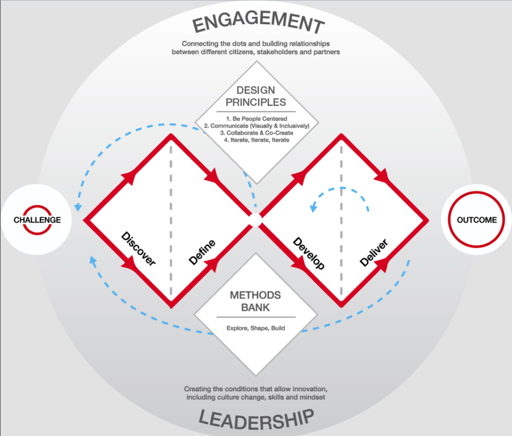

```

This framework involves iteration within the overall process, which is focused around converging first to a definition of the problem, and then delivering an outcome ('the design'). In contrast, more traditional civil engineering processes have often tended towards a multi-phased approach, wherein a project progresses from feasibility, through concept and preliminary design stages, towards a detailed design that then forms the basis for tendering and/or construction (see for example @NSW:2025aa and @Hillier:2022aa). While this includes many steps, the entire process appears to be involve just a single convergence on delivering a detailed design. Techno-rational policy-cycle models that dominate transport policy-making [@Marsden:2017aa] may involve some divergence within issue identification and options generating steps, but tend to leave convergence until post-analysis decision-making, while iteration happens through evaluation, to start the next policy cycle, rather than within a single turning. 

This may help to explain the "Arnstein Gap" [@Bailey:2006aa], which is a finding that, while public might desire true involvement or control of decision-making related to transport policy-making, through partnership, delegationg or citizen control, they tend to only receive tokenism (informing, consultation or placation) or are not really involved at all (i.e. public involvement as therapy or manipulation)(see also @Arnstein:1969aa). This gap between desired and delivered in decision making then appears to lead to frustration, opposition and delegitimisaion.  However, if planners, engineers and other technical specialists are already past issue identification, option development and analysis, and well on the way to converging on a detailed design to present as the 'preferred option' to the 'real' decision makers (e.g. political or institutional leaders), then there may be little appetite for engaging in public consultation that involves returning to discovery or problem definition, or in diversions that introduce further options.  

In *Transforming Future Mobility* @Coxon:2018aa outline how user-centric design processes typical in industrial design can be applied to transport systems.  This includes a mapping of various design approaches across dimensions of: research- or design-led; and expert/designer-only or collaborative, as shown in Figure \ref{fig:Coxon_user-centric_design_approaches}. They discuss a "fundamental shift...while 20th century design ... was the century of the *object*, the 21st century is beginning to be the centurary of the *user*", and how user-centric design, where "(t)o the designer, the user or passenger is an object of study...reacting to the designed outcomes in the hope of a satisfactory fit", when developed "still further leads us to a prticipatory approach between design expert and the user...(who) are seen much more as partners in the creation of designed outcomes...as the experts in their own domain and ... valued as co-creators...actively involved in idea generation" [@Coxon:2018aa]. 


```{r Coxon_user-centric_design_approaches, include=TRUE, echo=FALSE, out.width = "100%", fig.margin = FALSE, fig.cap = "Mapping user-centred design approaches. Source: Coxon et al (2018b)", crop = TRUE}

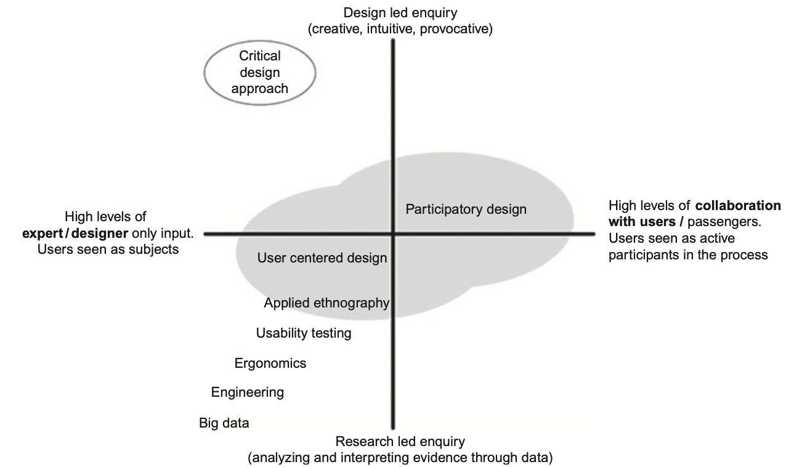

```

*Critical design approach* is identified as "(at) the most avant-garde end of the spectrum...(where) designers reject the role of design as being limited to the production of objects and instead focus on a rationale that seeks to address matters of concern through provocative and unfamiliar interactions (Malpass, 2017)"[@Coxon:2018aa]. At first glance, avant-gardism, provacation and interactions that challenge the status quo would seem to be out of place in transport systems, and having more in common with artistic endeavor and performance. However, there is a long history of such interventions being used in the context of transport systems, especially on roadways, including: street reclaiming; *PARKing Day*; 'guerilla' knitting, gardening and bike lanes; tactical urbanism; World Naked Bike Ride, and the No Pants Surbway Ride; Critical Mass; various protest movements relating to bus, bicycle or other lanes, or other topics; the invention of the *woornerf*; and many more [@Engwicht:1999aa; @Fotel:2009aa; @Institute:2015aa; @Dobson:2023ae; @Ride:2009aa; @Alisdairi:2014aa; @Blumgart:2016ab; @Davidson:2013aa; @Garcia:2019aa; @Lydon:2012aa; @Lydon:2015aa; @Transportation-Studies:2019aa; @Anonymous:2004aa; @Jordan:2009aa; @Lucas:2009ab; @Mitchell:2008aa; @ONeil:2018aa; @Ferguson:2025aa; @Fucoloro:2013aa; @Gorgan:2019aa; @Morhayim:2012aa; @Guttenberg:1982aa]. In part this may be an overlapping of concepts, but something that the parts of the transport policy research field that are embedded within the technical traditions of planning and engineering do not often interact with, or when they do interactions are framed within normative conceptions of legitimacy of road rules, authority and ownership. @Reynolds:2020aa and @Reynolds:2021ab cover this in more detail, including through discussion of the legitimacy of graffiti and who gets to make 'street art' and how these topics are informing Movement and Place, and other emerging road network operating approaches (see also @Reynolds:2025aa, @Dovey:2012aa; @Fogarty:2016aa; @Killen:2017aa; @Florance:2017aa). Public decision making processes are one of the nine pragmatic strategies for legitimising transit prioritisation emerging from @Reynolds:2020aa and @Reynolds:2021ab, but the 'performance' aspects of legitimising through implementation involved in (7) bottom-up and incremental, (8) pop-ups and (9) trials would appear to link to the elements of *critical design approach* that relate to reframing of the familiar and demonstrating the possibility of change.  

Perhaps, to some extent, the ROBUST project itself is akin to such a *critical design approach*, as the trialing of new shared electric mobility technologies might challenge existing concepts of what a mobility hub is, how people might move through environments, motive power and recharging, and the cultural importance of private vehicle ownership. That all sounds somewhat abstract, however, so returning to @Coxon:2018aa (pp. 189-211) gives some examples of how to actualise Double Diamond and related industrial design approaches in the context of transport systems, including through: *service design*^[which "looks beyond the object or the
space to capture and integrate a conceptual plan that engages the organisation
of people, infrastructure, communication and the material components of a ser-
vice" (p.189).]; studies of service / system failures; journey mapping; experiential travel diaries; shadowing; diagrammatic mapping; interviews; questionnaires; cognitive mapping; 3D modeling; visualisation; triangulation methods, being investigator triangulation (multipe researchers), database triangulation and method triangulation; categorisation and subdivision (including through card sorting approaches); brainstorming and *bodystorming*^[Involving physical mock ups.]; drawing; 3D printing; immersive simulations, including though involving haptic feedback devices; and agent-based modelling. Further methodologies are discussed in various chapters of *Advancing a Design Approach to Enriching Public Mobility*, including:

- design anthropology^[encompassing concepts related to *emergence*, *improvisation*, *knowing*, and *learning*]; in-car video enthographies^[reenacting routines with participants]; *Wizard of Oz studies*^[Autonomous vehicle studies where a hidden researcher drives the car to simuluate a driverless vehicle]; workshops with 'probes' such as disruption cards, video drive-along clips, journey maps (see Figure \ref{fig:Pink_commute_map}, prompt tables (see Figure \ref{fig:Pink_prompt_tables} storyboards and pain point maps, and facilitated discussions; a *Drive-Me* study involving use of research vehicles for 18 months by families, during which researchers undertook "home visits, drive and commute alongs, speculative future scenarios, discussions and mapping activities over a shared take-away meal...(which) included mapping the technologies and 'stuff' kept in the car" [@Pink:2021aa]; 


```{r Pink_commute_map, include=TRUE, echo=FALSE, out.width = "100%", fig.margin = FALSE, fig.cap = "An example of a how to map a person’s commute routine and how different modes of transportation become part of it. Map created by Kaspar Raats and Katalin Osz, Source: Pink et al (2021)", crop = TRUE}

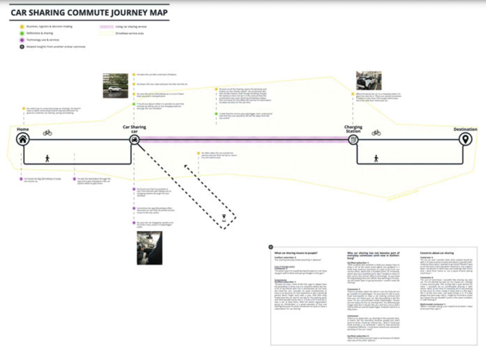

```

```{r Pink_prompt_tables, include=TRUE, echo=FALSE, out.width = "100%", fig.margin = FALSE, fig.cap = "Map of different stakeholder perspectives in creating a joint mobility technology. Photograph by Thomas Lindgren Source: Pink et al (2021)", crop = TRUE}

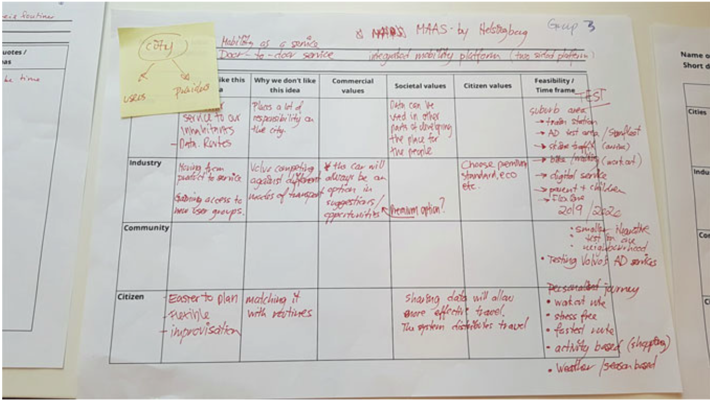

```

- visual conflict framing (Figure \ref{@Fridman_train_doors}) and reframing (Figure \ref{@Fridman_reframe}) in which a problem is approached as if it is a problem with something else^["...if the problem of battery weight was approached as if it was problem of demand responsiveness, then the solution should be to design using modularity" where smaller buses are connected and disconnected according to demand, rather than carrying around a larger bus (and battery) just for the peak demand (p.32)][@Fridman:2021aa];

```{r Fridman_train_doors, include=TRUE, echo=FALSE, out.width = "100%", fig.margin = FALSE, fig.cap = "Visual conflict framing of train factors. Diagram referenced from Coxon [9]. Source: Fridman and Coxon (2021)", crop = TRUE}

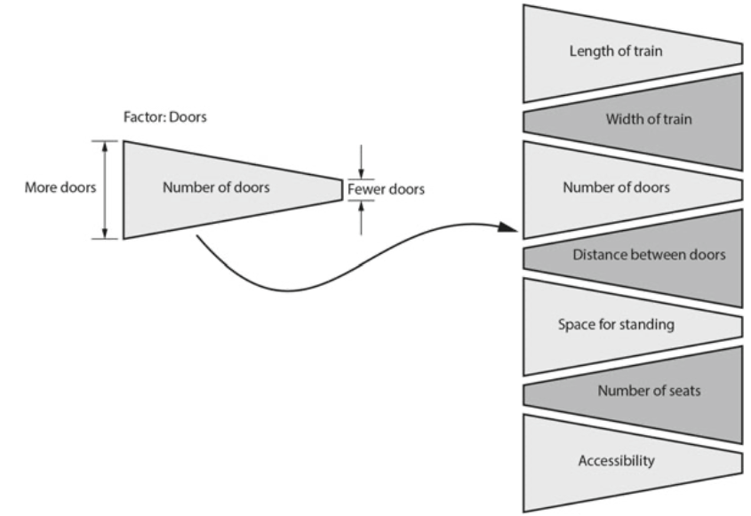

```

```{r Fridman_reframe, include=TRUE, echo=FALSE, out.width = "100%", fig.margin = FALSE, fig.cap = "Visual conflict re-framing of bus factors. Source: Fridman and Coxon (2021)", crop = TRUE}

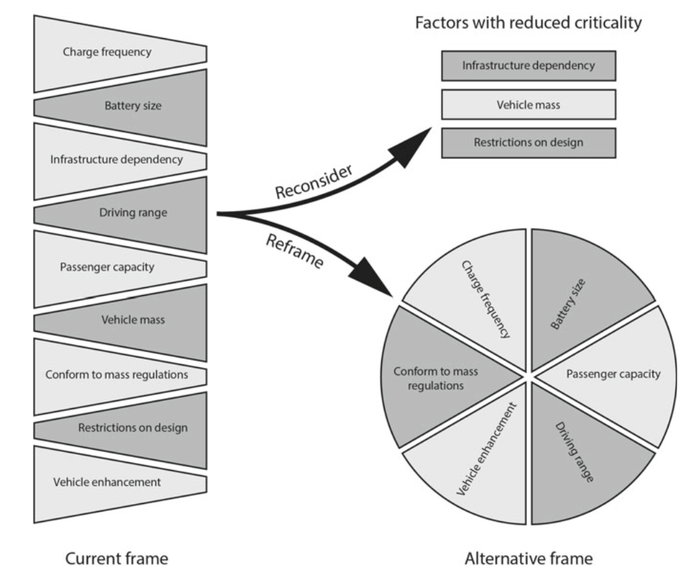

```


- the Hexagon Spindle (HS) Model, used with surveys, interviews, observations, focus group discussions and expert interviews by @Woodcock:2021aa; 

```{r Woodcock_spindle, include=TRUE, echo=FALSE, out.width = "100%", fig.margin = FALSE, fig.cap = "KPIs for female travellers mapped on to the HS model. Source: Woodcock et al (2021).", crop = TRUE}

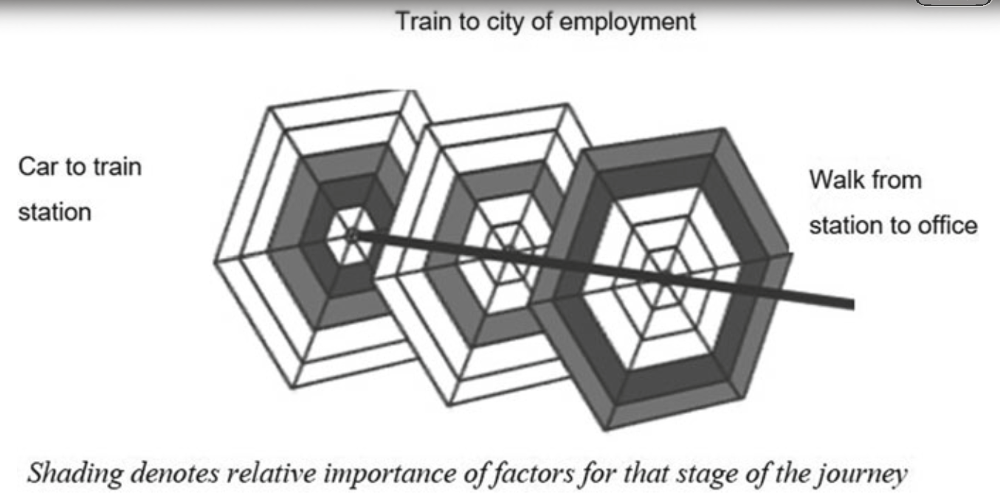

```

```{r Woodcock_stages, include=TRUE, echo=FALSE, out.width = "100%", fig.margin = FALSE, fig.cap = "Stages of a commuter’s journey. Shading denotes relative importance of factors for that lies with other service providers. Source: Woodcock et al (2021).", crop = TRUE}


```


- crowd sourcing, as in @Matthewson:2021aa; 

- drawing and LEGO models used for exploration, development and engagement, as in @Napper:2021aa


```{r Napper_drawing, include=TRUE, echo=FALSE, out.width = "100%", fig.margin = FALSE, fig.cap = "An example of the two-dimensional drawing used in the research. Source: Napper et al (2021).", crop = TRUE}

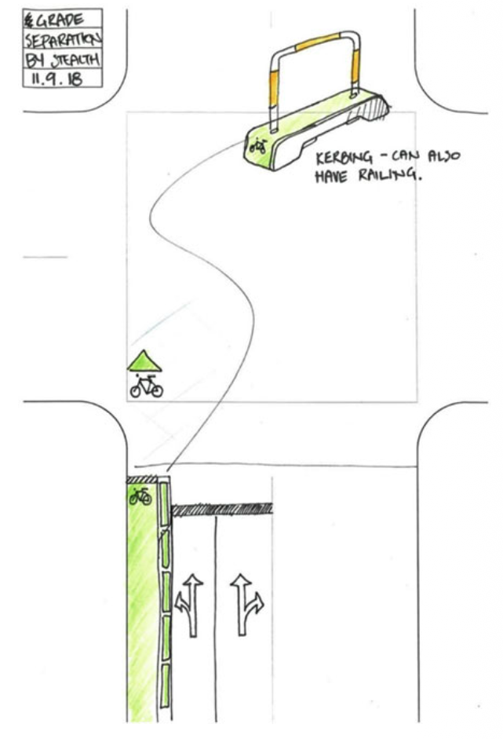

```

```{r Napper_lego, include=TRUE, echo=FALSE, out.width = "100%", fig.margin = FALSE, fig.cap = "Typical LEGO model used in the research. Source: Napper et al (2021).", crop = TRUE}

knitr::include_graphics("graphics/Napper_lego.png")

```

- storyboarding [@Johnson:2021aa]; 
- iterative testing using a user experience design approach through facilitated task completion by members of the public within a one-to-one scale mock-up [@Gaitan:2021aa]; and
- prototyping and seeking stakeholder feedback (e.g. @Rane:2021aa, @Jolivet:2021aa, @Killen:2021aa and @Gray:2021aa). 


```{r Bhandari_hierarchy, include=TRUE, echo=FALSE, out.width = "100%", fig.margin = TRUE, fig.cap = "Hierarchy of common opinio-based research methods. Source: Bhandari and Hallowell (2021).", crop = TRUE}

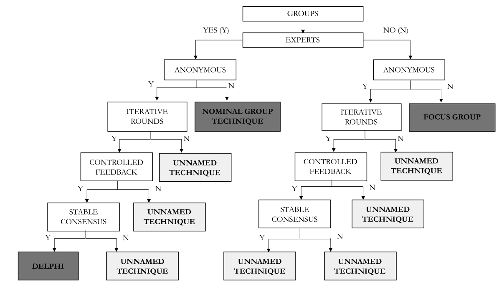

```


Beyond these approaches there appear to be a wide range of techniques, formats and other ways in which feedback or input from users, stakeholders, experts or others might be sort in research, marketing, design or other endeavours. @Bhandari:2021aa present a heirarchy of common methods, including Delphi, Nominal Group and Focus Group. Notably there are a large number of variations, lacking formal names, which @Bhandari:2021aa suggests might arise because of a desire to use one of the named methods but constraints leading to compromises and use a something that is not quite the same "(e.g., modified Delphi)".  

@Bhandari:2021aa suggests that researchers and practitioners should instead focus on the control-types used, be it: single-blinded anonymity; double-blinded anonymity; iterative rounds with statistical feedback; iterative rounds with descriptive feedback; randomizations; background checks; and/or giving participants a sense of ownership and/or personal accountability for the outcomes. These are crosstabulated to common biases that might impact individual and group decision-making (Figure \ref{fig:Bharndari_bias}), leading to a synthesis of how control options might be combined to remove some or all of the potential biases (Figure \ref{fig:Bharndari_options}), although it notes that there is a need for further research that "not only should seek to investigate the effectiveness of various pupular debaising stretegies from literature fore the CEM (construction engineering and management) domain but also should establish empirically the balure of research controls in managing and minimizing biases for opinion-based research" [@Bhandari:2021aa]


```{r Bharndari_bias, include=TRUE, echo=FALSE, out.width = "100%", fig.margin = FALSE, fig.cap = "Cross tabulation of cognitive biases and research controls. Source: Bhandari and Hallowell (2021).", crop = TRUE}

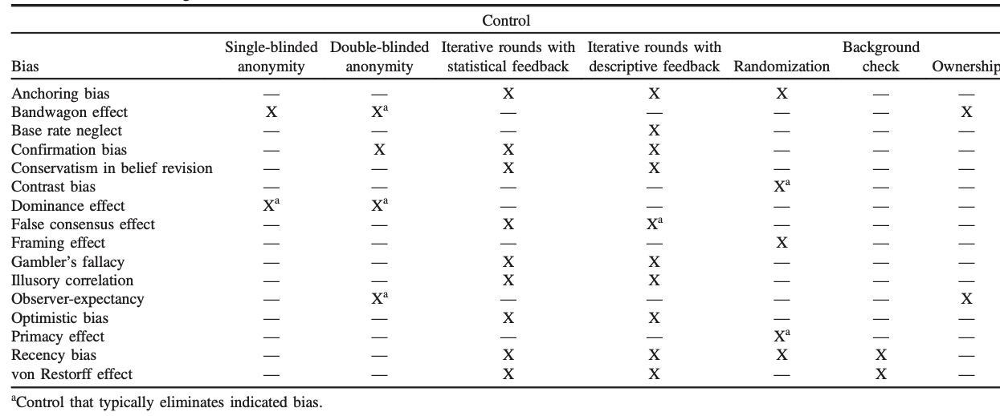

```


```{r Bhandari_options, include=TRUE, echo=FALSE, out.width = "100%", fig.margin = FALSE, fig.cap = "Expert-opinion research options. Source: Bhandari and Hallowell (2021).", crop = TRUE}

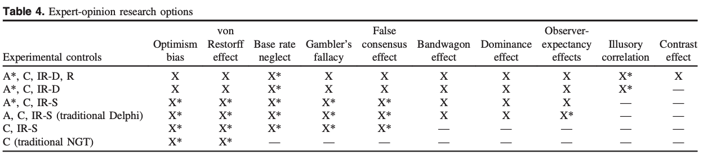

```


NOT ONLY A LACK OF RESEARCH IN CONSRUCTION ENGINEERING AND MANAGEMENT, BUT ALSO INTO THE DESIGN OF SHARED ELECTRIC MOBILITY HUBS - WHICH IS THE FOCUS HERE.


# Methodology 
## Case research 

## Co-design workshops
### Stakeholders

### General Public


# Results

# Discussion

# Conclusions

## Directions for future research


# References


```{css, echo=FALSE}
div.fullwidth > table {
  width: 100%;
}
```

```{r bib, include=FALSE}
# create a bib file for the R packages used in this document
knitr::write_bib(, file = 'skeleton.bib')
```
