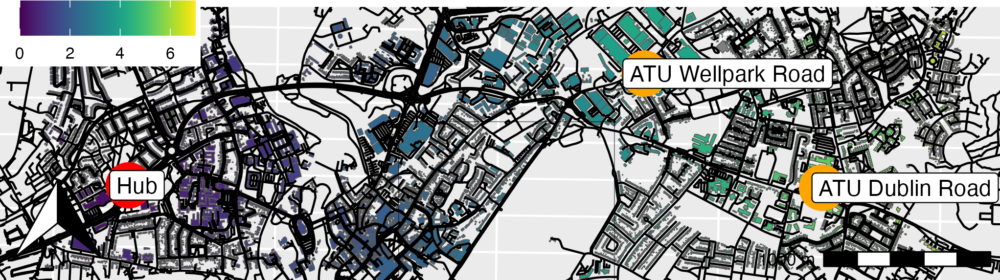
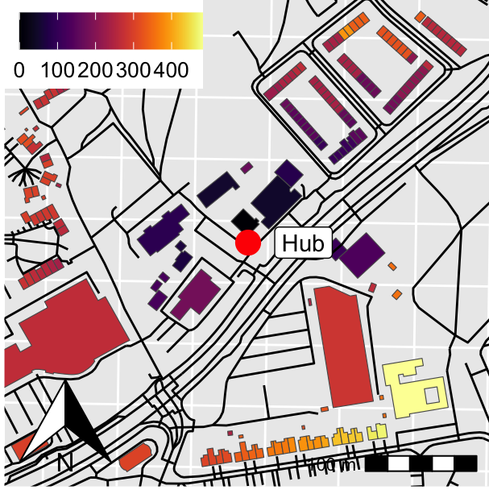

```{r setup, include=FALSE}
library(tufte)
library(ggplot2)
library(tidyverse)
library(sf)
library(viridis)
library(janitor)
library(knitr)
library(kableExtra)

# invalidate cache when the tufte version changes
knitr::opts_chunk$set(cache.extra = packageVersion('tufte'))
options(htmltools.dir.version = FALSE)
```

```{r logo, echo=FALSE, fig.margin = TRUE, out.width="100%"}

knitr::include_graphics("graphics/robust-logo-news.png") 

```

Railway stations 
and other transport nodes
often do 
more than just move people and goods - they might also be places with shopping, food, other services and facilities, and provide a '3rd space' for community interaction. Along similar lines, recent research has emphasised 
the important of the `Place’ function for roads, 
alongside the more traditional focus in traffic engineering on the demensions of movement and access to adjoining land uses[@Delbosc:2018aa]. 


```{r bikes, include=TRUE, echo=FALSE, out.width = "100%", fig.margin = TRUE, fig.cap = "E-bikes @ the Galway hub", crop = TRUE}


knitr::include_graphics("graphics/galway_bikes.png") 

```

Shared electric mobility hubs are new 
form of transport node that might 
support more sustainable travel choices, 
especially in contexts such as lower density suburbs where providing high frequency transit services 
is challenging. 
These may help provide transition pathways 
towards lower carbon-emitting
transport systems 
without some of the problems associated with other forms of shared and micro-mobility (e.g. charging fire risks, inappropriate parking of dockless bikes and scooters [@Zhang:2022aa; @Ferguson:2025aa]). Such hubs may also allow households to 
shift towards more walking, cycling and transit use, including through facilitating those occasional trips 
that might otherwise be challenging (e.g. beyond walking/cycling distance, outside typical service times, carrying luggage). 

Four shared e-mobility hubs have been implemented in 
Letterkenny, Galway, Waterford and Dundrum, with 
each including e-bikes, 
an e-cargo bike and shared electric cars 
as an inital offering, 
plus *power supply infrastructure* to support current on-site recharging 
and other *future uses*.
These represent a considerable capital investment in mobility infrastructure and potential opportunities for further development. 
However, 
it is unclear how community use of these hubs 
might best be supported so as to improve transport sustainability, or how the hubs and surrounds might better meet local needs^[
Perhaps the hub can support existing local programs and activities 
(e.g. vehicle use by meals-on-wheels, sporting clubs, for library programs or by council staff to support service delivery)? Or 
they might allow for pop-ups or additional facilities (e.g. café, luggage storage, delivery services) that increase activity and therefore  
improve safety and security (i.e. through Jane Jacob's "eyes on the street").].

The ROBUST research project seeks 
better understanding of: the
encouragement, 
educational 
and other 'non-(major)-infrastructure' interventions[@Williams:1993aa]
that might support community use of hubs; how to expand the mobility offer; and to 
build partnerships with community and other stakeholders
so as to maximise impacts of each hub's implementation. To this end, ATU is hosting Co-design Workshops with key stakeholders 
to gain bottom-up insights from practitioners, 
prior to further engagement. 
This note provides details of the agenda for the second Co-design Workshop, to be held in Galway on the morning of Wednesday 8th April, 2026^[Objectives include: 1. Stakeholder engagement, and an opportunity for practitioners to try the hub out for themselves! 2. Increase coordination of efforts going forward; 3. Initial steps towards further co-design workshops, potentially involving community stakeholders, and increasing the mobility hub offer.].  


## 8:00am: meet at hub

The Galway hub is close to the Westside Library carpark. We will meet there, inspect the site and then use the hub's vehicles to reach ATU for morning coffee/tea.  


```{r extract_osm_data, eval=FALSE, include=TRUE, echo=FALSE, warning=FALSE, message=FALSE }

placebb <- list()
placebb$letterkenny <- getbb("Letterkenny Urban ED")
placebb$galway <- getbb("Galway City")
placebb$waterford <- getbb("Waterford")
placebb$dundrum <- getbb("Dundrum")

##SAVE AS OSMDATA object
#buildings <- lapply(placebb, function(x) x %>% opq() %>%
#  add_osm_feature(key = "building") %>%
#  osmdata_sf())
#list.save(buildings, "data/buildings.rdata")
buildings <- list.load("data/buildings.rdata")

##SAVE AS SF OBJECTS
#opq (placebb$letterkenny) |>
#    add_osm_feature (key = "building") |>
#    osmdata_xml (filename = "data/letterkenny_buildings.osm")
#opq (placebb$galway) |>
#    add_osm_feature (key = "building") |>
#    osmdata_xml (filename = "data/galway_buildings.osm")
#opq (placebb$waterford) |>
#    add_osm_feature (key = "building") |>
#    osmdata_xml (filename = "data/waterford_buildings.osm")
#opq (placebb$dundrum) |>
#    add_osm_feature (key = "building") |>
#    osmdata_xml (filename = "data/dundrum_buildings.osm")

sf_object_filenames <- list(
  letterkenny = "data/letterkenny_buildings.osm",
  galway = "data/galway_buildings.osm", 
  waterford = "data/waterford_buildings.osm", 
  dundrum = "data/dundrum_buildings.osm")

# Load layers
buildings_points <- lapply(sf_object_filenames, function(x) sf::st_read(x, layer = "points", quiet = TRUE))
buildings_lines <- lapply(sf_object_filenames, function(x) sf::st_read(x, layer = "lines", quiet = TRUE))
#buildings_polygons <- lapply(sf_object_filenames, function(x) sf::st_read(x, layer = "polygons", quiet = TRUE))
#buildings_multilines <- lapply(sf_object_filenames, function(x) sf::st_read(x, layer = "multilines", quiet = TRUE))
buildings_multipolygons <- lapply(sf_object_filenames, function(x) sf::st_read(x, layer = "multipolygons", quiet = TRUE))
## Note, no data in the polygon or multilines layers it seems

### Convert all to metres
buildings_points <- lapply(buildings_points, function(x) x %>% 
  st_transform(crs = 2157))
buildings_lines <- lapply(buildings_lines, function(x) x %>% 
  st_transform(crs = 2157))
buildings_multipolygons <- lapply(buildings_multipolygons, function(x) x %>% 
  st_transform(crs = 2157))

hub_location <- lapply(hub_location, function(x) x %>% 
  st_as_sf(coords = c("lon", "lat"), 
           crs = 4326) %>%
  st_transform(crs = 2157) %>% 
  st_cast("POINT"))

### Calculate distances to hubs - straight line (as the crow flies)
buildings_points$letterkenny <- buildings_points$letterkenny %>% 
  mutate(distance_to_hub = st_distance(buildings_points$letterkenny, hub_location$letterkenny))
buildings_points$galway <- buildings_points$galway %>% 
  mutate(distance_to_hub = st_distance(buildings_points$galway, hub_location$galway))
buildings_points$waterford <- buildings_points$waterford %>% 
  mutate(distance_to_hub = st_distance(buildings_points$waterford, hub_location$waterford))
buildings_points$dundrum <- buildings_points$dundrum %>% 
  mutate(distance_to_hub = st_distance(buildings_points$dundrum, hub_location$dundrum))

buildings_lines$letterkenny <- buildings_lines$letterkenny %>% 
  mutate(distance_to_hub = st_distance(buildings_lines$letterkenny, hub_location$letterkenny))
buildings_lines$galway <- buildings_lines$galway %>% 
  mutate(distance_to_hub = st_distance(buildings_lines$galway, hub_location$galway))
buildings_lines$waterford <- buildings_lines$waterford %>% 
  mutate(distance_to_hub = st_distance(buildings_lines$waterford, hub_location$waterford))
buildings_lines$dundrum <- buildings_lines$dundrum %>% 
  mutate(distance_to_hub = st_distance(buildings_lines$dundrum, hub_location$dundrum))

buildings_multipolygons$letterkenny <- buildings_multipolygons$letterkenny %>% 
  mutate(distance_to_hub = st_distance(buildings_multipolygons$letterkenny, hub_location$letterkenny))
buildings_multipolygons$galway <- buildings_multipolygons$galway %>% 
  mutate(distance_to_hub = st_distance(buildings_multipolygons$galway, hub_location$galway))
buildings_multipolygons$waterford <- buildings_multipolygons$waterford %>% 
  mutate(distance_to_hub = st_distance(buildings_multipolygons$waterford, hub_location$waterford))
buildings_multipolygons$dundrum <- buildings_multipolygons$dundrum %>% 
  mutate(distance_to_hub = st_distance(buildings_multipolygons$dundrum, hub_location$dundrum))


## NEXT Use dodgr to obtain distance by network
#net <- lapply(placebb, function(x) dodgr_streetnet(x))
#list.save(net, "data/net.rdata")
net <- list.load("data/net.rdata")
net_foot <- lapply(net, function(x) weight_streetnet (x, wt_profile = "foot"))
net_bicycle <- lapply(net, function(x) weight_streetnet (x, wt_profile = "bicycle"))
net_motorcar <- lapply(net, function(x) weight_streetnet (x, wt_profile = "motorcar"))

maps_of_street_networks <- lapply(net, function(x) osm_basemap (x, bg = "gray95") %>%
    add_osm_objects (x, col = "gray5") %>%
    add_axes () %>%
    print_osm_map ())


# Add distance by foot, bike and car
for(i in seq_along(placebb)){
buildings_multipolygons[[i]] <- buildings_multipolygons[[i]] %>% mutate(distance_by_foot = dodgr_dists(net_foot[[i]], from = st_geometry(
    buildings_multipolygons[[i]]) %>%
    st_centroid() %>%
    st_transform(crs = 4326) %>% 
      st_coordinates(),
  to =  st_geometry(
    hub_location[[i]]) %>%
    st_centroid() %>%
    st_transform(crs = 4326) %>% 
      st_coordinates()
) %>% 
  as.numeric())

buildings_multipolygons[[i]] <- buildings_multipolygons[[i]] %>% mutate(distance_by_bicycle = dodgr_dists(net_bicycle[[i]], from = st_geometry(
    buildings_multipolygons[[i]]) %>%
    st_centroid() %>%
    st_transform(crs = 4326) %>% 
      st_coordinates(),
  to =  st_geometry(
    hub_location[[i]]) %>%
    st_centroid() %>%
    st_transform(crs = 4326) %>% 
      st_coordinates()
) %>% 
  as.numeric())

buildings_multipolygons[[i]] <- buildings_multipolygons[[i]] %>% mutate(distance_by_motorcar = dodgr_dists(net_motorcar[[i]], from = st_geometry(
    buildings_multipolygons[[i]]) %>%
    st_centroid() %>%
    st_transform(crs = 4326) %>% 
      st_coordinates(),
  to =  st_geometry(
    hub_location[[i]]) %>%
    st_centroid() %>%
    st_transform(crs = 4326) %>% 
      st_coordinates()
) %>% 
  as.numeric())
}

##SAVE DATASETS
list.save(buildings_multipolygons, "data/buildings_multipolygons.rdata")
list.save(hub_location, "data/hub_location.rdata")
list.save(map_by_foot, "data/map_by_foot.rdata")
list.save(maps_of_street_networks, "data/maps_of_street_networks.rdata")
list.save(net, "data/net.rdata")
list.save(net_bicycle, "data/net_bicycle.rdata")
list.save(net_foot, "data/net_foot.rdata")
list.save(net_motorcar, "data/net_motorcar.rdata")
list.save(placebb, "data/net_placebb.rdata")


```


```{r create_maps_by_foot, eval=FALSE, include=FALSE, echo=FALSE}


buildings_multipolygons <-  list.load( "data/buildings_multipolygons.rdata")
hub_location <- list.load("data/hub_location.rdata")
net <-  list.load( "data/net.rdata")
placebb <- list.load("data/net_placebb.rdata")


atu_location <- list(
  letterkenny = tibble(lat=54.95208986595597, lon = -7.720974603599577, name = "ATU Letterkenny campus"), 
  galway_dublin_road = tibble(lat=53.277740727608354, lon = -9.010693102313253, name = "ATU Galway City - Dublin Road campus"), 
galway_wellpark_road = tibble(lat=53.28378951504243, lon = -9.026857886967322, name = "ATU Galway City - Wellpark Road"))
atu_location <- lapply(atu_location, function(x) x %>% 
  st_as_sf(coords = c("lon", "lat"), 
           crs = 4326) %>%
  st_transform(crs = 2157) %>% 
  st_cast("POINT"))


map_by_foot <- list()
for(i in seq_along(placebb)){
  
ylim = c((st_bbox(hub_location[[i]]) %>% 
    as.numeric())[2] - 200,
    (st_bbox(hub_location[[i]]) %>% 
    as.numeric())[2] + 200)
xlim = c((st_bbox(hub_location[[i]]) %>% 
    as.numeric())[1] - 200,
    (st_bbox(hub_location[[i]]) %>% 
    as.numeric())[1] + 200)
Poly_Coord_df = data.frame(xlim, ylim)
poly <- Poly_Coord_df %>% 
  st_as_sf(coords = c("xlim", "ylim"), 
           crs = 2157) %>% 
  st_bbox() %>% 
  st_as_sfc()

map_by_foot[[i]] <- ggplot() + 
  geom_sf(data = buildings_multipolygons[[i]] %>%
  st_filter(poly, .predicate =  st_intersects), mapping = aes(fill = distance_by_foot)) + 
  
scale_fill_viridis(option = "B", labels = comma) + 
  theme(
        axis.title = element_blank(), 
        axis.text.x=element_blank(), #remove x axis labels
        axis.ticks.x=element_blank(), #remove x axis ticks
        axis.text.y=element_blank(),  #remove y axis labels
        axis.ticks.y=element_blank(), #remove y axis ticks
        legend.position="bottom",
        legend.text = element_text(size = 10), 
        legend.title = element_blank(),
        ) + 
  geom_sf(data = net[[i]], aes()) + 
  geom_sf(data = hub_location[[i]], size = 5, colour = "red") + 
  geom_sf_label(data = hub_location[[i]], label = "Hub", nudge_x = 50) +
  coord_sf(xlim, ylim) +
  ggspatial::annotation_scale(location = 'br') + 
  ggspatial::annotation_north_arrow() 
#  labs(
#  title=paste((placebb %>% names())[i]))
}

 ggsave(file = "graphics/galway_by_foot_small.png", plot = map_by_foot[[2]], scale = 1) 

map_by_foot <- list()
for(i in seq_along(placebb)){
  
ylim = c((st_bbox(hub_location[[i]]) %>% 
    as.numeric())[2] - 500,
    (st_bbox(hub_location[[i]]) %>% 
    as.numeric())[2] + 1000)
xlim = c((st_bbox(hub_location[[i]]) %>% 
    as.numeric())[1] - 500,
    (st_bbox(hub_location[[i]]) %>% 
    as.numeric())[1] + 5000)
Poly_Coord_df = data.frame(xlim, ylim)
poly <- Poly_Coord_df %>% 
  st_as_sf(coords = c("xlim", "ylim"), 
           crs = 2157) %>% 
  st_bbox() %>% 
  st_as_sfc()

map_by_foot[[i]] <- ggplot() + 
  geom_sf(data = buildings_multipolygons[[i]] %>%
  st_filter(poly, .predicate =  st_intersects), mapping = aes(fill = distance_by_foot / 1000)) + 
  scale_fill_viridis(labels = comma, limits = c(0, 7)) + 
  theme(
        axis.title = element_blank(), 
        axis.text.x=element_blank(), #remove x axis labels
        axis.ticks.x=element_blank(), #remove x axis ticks
        axis.text.y=element_blank(),  #remove y axis labels
        axis.ticks.y=element_blank(), #remove y axis ticks
        legend.position="bottom",
       legend.text = element_text(size = 8), 
        legend.title = element_blank(),
        ) + 
  geom_sf(data = net[[i]], aes()) + 
  geom_sf(data = hub_location[[i]], size = 10, colour = "red") + 
  geom_sf_label(data = hub_location[[i]], label = "Hub", nudge_x = 50) +
  geom_sf(data = atu_location[[2]], size = 10, colour = "orange") + 
  geom_sf_label(data = atu_location[[2]], label = "ATU Dublin Road", nudge_x = 500) +
   geom_sf(data = atu_location[[3]], size = 10, colour = "orange") + 
  geom_sf_label(data = atu_location[[3]], label = "ATU Wellpark Road", nudge_x = 500) +
  coord_sf(xlim, ylim) +
  ggspatial::annotation_scale(location = 'br') + 
  ggspatial::annotation_north_arrow() 
#  labs(
#  title=paste((placebb %>% names())[i]))
}
ggsave(file = "graphics/galway_by_foot_large.png", plot = map_by_foot[[2]], scale = 1) 


```

```{r plot_maps_by_foot, include=TRUE, echo=FALSE, out.width = "100%", fig.fullwidth = FALSE, fig.cap = "Galway hub location by walking distance (km)", crop = TRUE}



```


```{r plot_maps_by_foot_small, include=TRUE, echo=FALSE, out.width = "100%", fig.margin = TRUE, fig.cap = "Galway hub surrounds, by walking distance (m)", crop = TRUE}



```

## 10:00am: co-design workshop

The @UK-Design-Council:0aa Double Diamond design process suggests alternate converging and diverging steps of: Discovery; Definition, Development and Delivery. The co-design workshop will spend roughly 30 minutes on each step, tackling issues such as: signage and linemarking; minor works and placemaking; community, business and council engagement and events; and others as discovered. 


```{r double_diamond, include=TRUE, echo=FALSE, out.width = "100%", fig.margin = TRUE, fig.cap = "Double Diamond process", crop = TRUE}

knitr::include_graphics("graphics/Double_Diamond.png")

```


## 12 noon: return vehicles and close
...followed by lunch at (TBD??)


## Details 
- Facilitators: James Reynolds^[julianj.reynolds@atu.ie or +353 87 348 3095. James is a post-doc researcher at ATU with more than 20 years of experience in transport engineering in Australia and Canada. He completed a PhD about legitimising transit prioritisation in 2020.] and Amaya Vega^[amaya.vega@atu.ie Amaya is a Senior Lecturer/Associate Professor in Economics at Atlantic Technological University (ATU) and Visiting Research Fellow at the Institute of International Economics at the University of Valencia, Spain. She has over 20 years’ experience working on transport policy evaluation, focusing on passenger and freight transport demand analysis, maritime transport, and ports.].
- Eight spaces available due to vehicle capacity limitations: 
  1. Evan Carney (Galway Council);
  2. Tiarnan McCusker (Galway Council); 
  3. Damien Redington (Community Climate Coordinator); 
  4. Denise Feeney (Community Climate Action Officer);
  5. Helen Melia (Senior Staff Officer, Community Section, Galway Council); 
  6. Colm Shaughnessy (Galway Council)
  7. Claire Connolly (PPN Galway Officer); 
  8. Silvana Falasca (PPN Galway Officer).
- Please bring a safety vest, sturdy shoes, a bicycle helmet and rain coat. 


```{r bib, include=FALSE}
# create a bib file for the R packages used in this document
knitr::write_bib(c('base', 'rmarkdown'), file = 'skeleton.bib')
```
