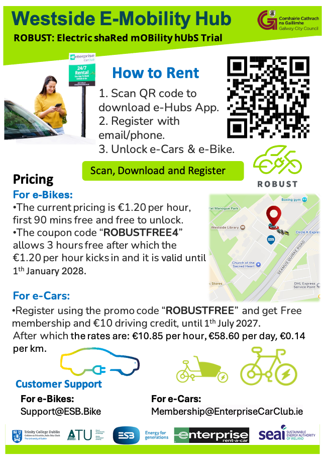

```{r setup, include=FALSE}
library(tufte)
library(ggplot2)
library(tidyverse)
library(sf)
library(viridis)
library(janitor)
library(knitr)
library(kableExtra)

# invalidate cache when the tufte version changes
knitr::opts_chunk$set(cache.extra = packageVersion('tufte'))
options(htmltools.dir.version = FALSE)
```

```{r logo, echo=FALSE, fig.margin = TRUE, out.width="100%"}

knitr::include_graphics("graphics/robust-logo-news.png") 

```


Dear ROBUST Galway co-design workshop 1 participants, 

Thank you for your inputs at the first ROBUST Co-design workshop a couple of weeks ago (23/9), and to the Climate Action Group for hosting us at the Westside Resource Centre.  

There was a lot to take in from all of your comments.  We will be looking closely at the materials developed in the workshop over the next weeks and months, with an aim to using your insights to improve the trial and better understand how shared electric mobility hubs might succeed here in Ireland or elsewhere.  

# Initial takeaways 

My initial takeaways from your comments are: 

- detailed information about how to use the apps, the system and pricing is especially important, both online and in physical format;
- the return-to-hub (A-to-A) model for the shared e-bikes and e-cargo-bikes might work better if there was a low daily cap (2 Euros was suggested), such that there is no need to rush back to the hub;
- availability of vehicles is important, and it was noted that there is currently only one cargo bike and one electric car at the Westside hub.

# Immediate steps

## Information 


```{r plot_robust_qr_code_to_youtube, include=TRUE, echo=FALSE, fig.margin = TRUE, out.width="100%", fig.cap="Draft mobility hub video at https://www.youtube.com/watch?v=hu9jsgi8CVU"}

knitr::include_graphics("graphics/robust_video.png")

```

I've put together a draft short video on the project, and how to use the e-bikes and e-cars.  See the QR code to the right (Figure 1).  We are working on more (and better) videos at the moment. Please let us know if you have any initial thoughts, and stay tuned for further versions.  Also, if you are interested in having a go and making your own videos or other forms of information about the hub please feel free to just go ahead, or drop us a line if you'd like to collaborate or get some help to get started. One of the interesting things about co-design is that everyone can take part if they would like too!

\newpage

```{r plot_robust_qr_code_to_website, include=TRUE, echo=FALSE, fig.margin = TRUE, out.width="100%", fig.cap="Draft mobility hub website, user facing version"}

knitr::include_graphics("graphics/robust_website.png")

```


Similarly, I've put together an initial draft website, which is accessible via the QR code in Figure 2 or at https://james-reynolds.github.io/ROBUST_Electric_shaRed_mOBility_hUbS_Trial_website/. This website is hosted on Github (QR code in Figure 3, or at https://github.com/James-Reynolds/ROBUST_Electric_shaRed_mOBility_hUbS_Trial_website), and uses open source software.  This means that you can edit it yourself and send me a 'pull request'. There are further details in the Readme of the github repository, or you can drop me an email or otherwise reach out if you'd like help getting started.  


```{r plot_robust_qr_code_to_github, include=TRUE, echo=FALSE, fig.margin = TRUE, out.width="100%", fig.cap="Draft mobility hub website, Github source code"}

knitr::include_graphics("graphics/robust_website_code.png")

```

## Pricing changes and free ride offers

Pricing changes have recently been made to the hub, and there are currently active promotional codes. See details in Figure 4 (also posted on the website).  


```{r galway_pricing, include=TRUE, echo=FALSE, fig.margin = TRUE, out.width="100%", fig.cap="Westside pricing leaflet"}



```

I'll look to reach out to the Trinity College Dublin (TCD) Project Manager (Sarbast Moselm) and see if we can introduce a daily cap to the e-bikes as part of the trial.  


## More workshops

Noreen and I just got back from running similar workshops in Waterford, and will be heading on to Letterkenny soon.  But, neither of us is far away, and we'd certainly be interested in coming back to get your further thoughts an insights as the trial progresses. 

More generally, I'm happy to come talk or otherwise interact about transport, implementation and policy-making, or pretty much any other related topic, so please let me know if that is of interest.  

All the best, 

James Reynolds^[email: james.reynolds@atu.ie]


\vspace{1cm}

PS Please also find enclosed a similar summary / follow-up from the Waterford workshops last week, if you are interested in further developments. 


