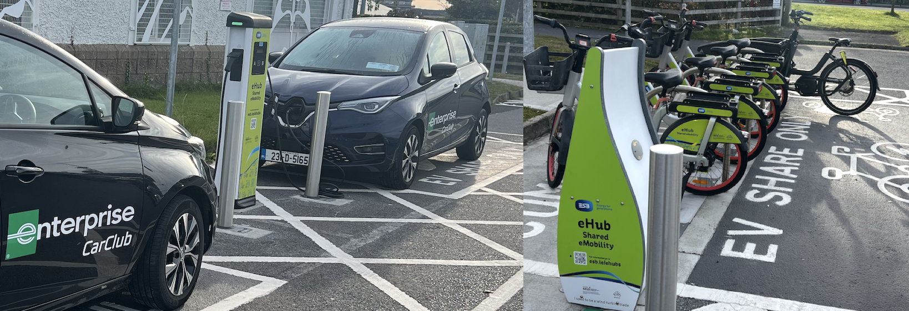
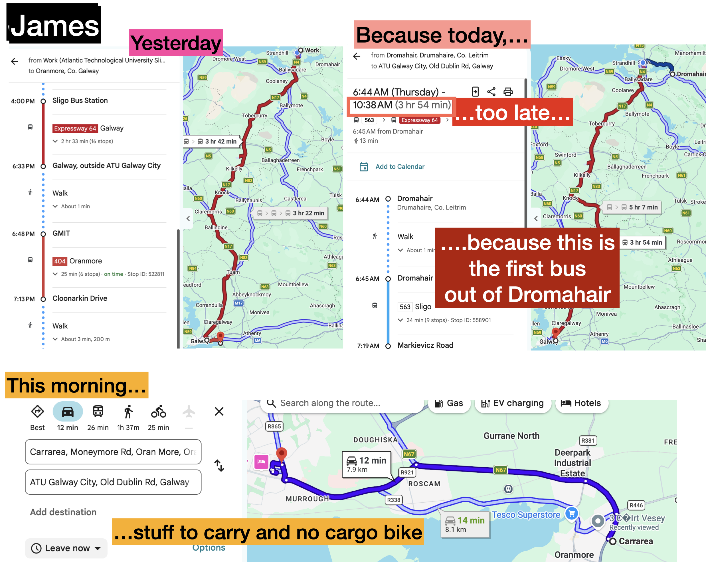
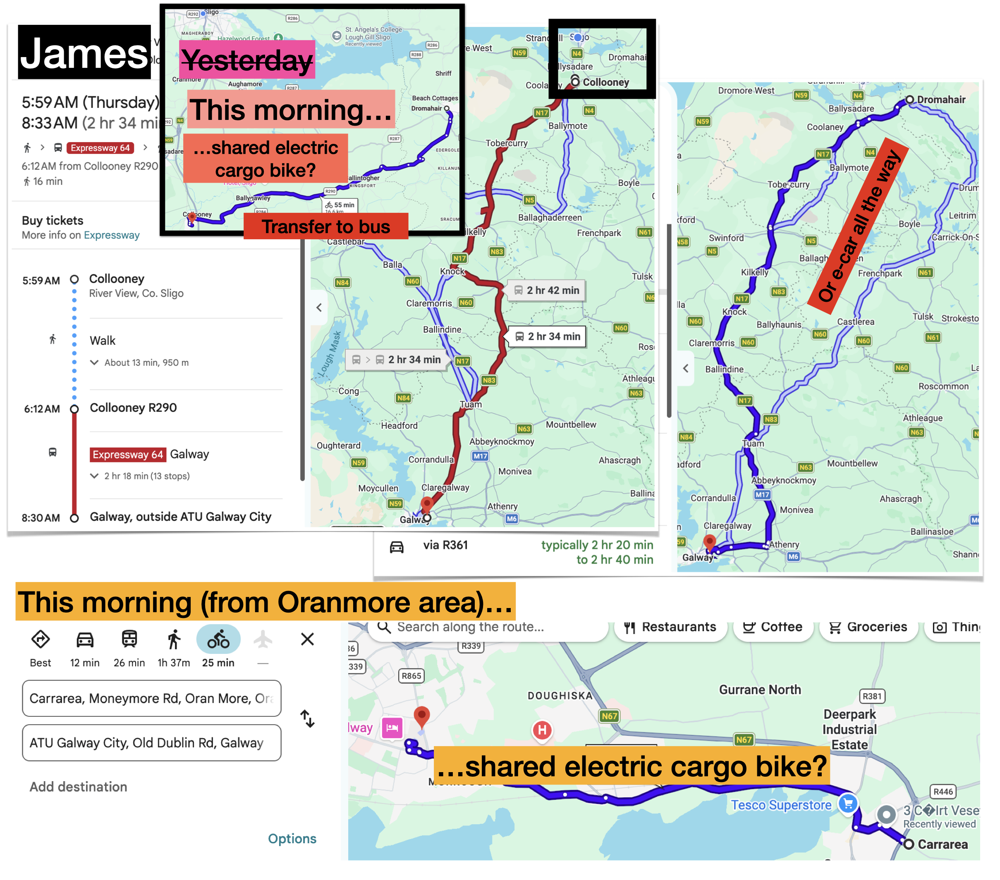
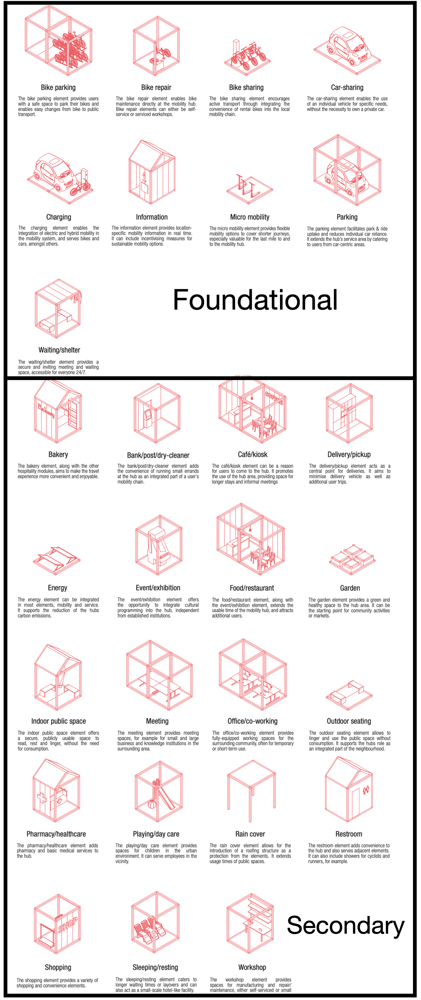

```{r setup, include=FALSE}
library(tufte)
library(ggplot2)
library(tidyverse)
library(sf)
library(viridis)
library(janitor)
library(knitr)
library(kableExtra)

# invalidate cache when the tufte version changes
knitr::opts_chunk$set(cache.extra = packageVersion('tufte'))
options(htmltools.dir.version = FALSE)
```

```{r logo, echo=FALSE, fig.margin = TRUE, out.width="100%"}

knitr::include_graphics("graphics/robust-logo-news.png") 

```

Welcome to a ROBUST co-design workshop. 

The QR code in Figure 1 links 
to an (initial draft) short video on the project, 
and how to use the e-bikes and e-cars at the hub. 

```{r plot_robust_qr_code_to_youtube, include=TRUE, echo=FALSE, fig.margin = TRUE, out.width="100%", fig.cap="Draft mobility hub video at https://www.youtube.com/watch?v=hu9jsgi8CVU"}

knitr::include_graphics("graphics/robust_video.png")

```


# What is a shared mobility hub?

"A shared mobility hub is a place where different transport modes are integrated seamlessly, promoting efficient and sustainable urban mobility. Emphasis is given on shared mobility options such as bikes, scooters and cars. Connection with public transport (transit) is desirable but not necessary. The integration between mobility suppliers is important to provide a seamless, flexible connection at these transfer points. Ensuring an enjoyable experience for travelers is a crucial part of the hub concept as well, and therefore the hub should be considered not just as a transfer node but as a place where a variety of services come together, such as logistics services or restaurants."[@Roukouni:2023aa]

# What is the ROBUST shared ELECTRIC mobility hub in Galway?

The Galway ROBUST hub is located close to the Westside library
and includes an 
e-cargo bike, 
four e-bikes
and (currently) one shared electric car. 
Included in the hub is dedicated parking and the
*power infrastructure* to support recharging of these vehicles onsite.  


```{r plot_hub_photo, eval=TRUE, include=TRUE, echo=FALSE, fig.margin = FALSE, out.width= "95%", fig.cap = "Electric cars, e-bikes and e-cargobike at the Galway (Westside) hub in 2025. Note there is now only one electric car at the Galway hub."} 




```


There is further information on an initial (draft) website^[https://james-reynolds.github.io/ROBUST_Electric_shaRed_mOBility_hUbS_Trial_website/]. This is accessible via the QR code in Figure 3 (next page).


# What is the PURPOSE of this workshop?


```{r plot_robust_qr_code_to_website, include=TRUE, echo=FALSE, fig.margin = TRUE, out.width="100%", fig.cap="Draft mobility hub website, user facing version"}

knitr::include_graphics("graphics/robust_website.png")

```   

This workshop seeks to improve research understandings of how best to implement 
shared electric mobility hubs, such as the one being trialled here in Galway. 
At this stage of the research we have *three key questions* that we would like your input on: 

- how does the return-to-origin (A-to-A) restriction impact on users and useability? 
- how can the hub offerings better meet community needs (including through expansion)?
- how can information about the hub and how to use it best be communicated? 


# What has come out of other workshops so far?
Follow-up notes with details of the findings so far are available on the draft website (QR code in Figure 3). But in summary:

\newthought{Galway (1 and 2)}(late September): 

- need detailed info about how to use systems,
- low daily cap for e-bikes due to A-to-A model (2 Euros?),
- availability of vehicles critical;

\newthought{Waterford (3 and 4)}(early October): 

```{r stickers, include=TRUE, echo=FALSE, fig.margin = TRUE, out.width="100%", fig.cap="First version of sticker for car chargers"}

knitr::include_graphics("graphics/charger_sticker_261009.png")

```

- reliability and availability may be limiting the potential but might be improved on with more local and community involvement in the day-to-day management,
- topography important^[Waterford is hilly!],
- weather protected seating or other 'pop-ups' a possibility, 
- potential for competition between Waterford and other hubs^[trips made or carbon saved leaderboards?],
- demographics ariund hub^[older, more apartment living and interest in car free life] might suggest other vehicle types?^[e-tricycles, tandam bikes for taking someone somewhere, more e-cargobikes, longer range e-bikes (many people already have bikes), e-vans, etc.], 
- problems with e-car charges being plugged in, but not activatived. Potential for sticker solution? (Figures 4 and 5); and


```{r stickers_test, include=TRUE, echo=FALSE, fig.margin = FALSE, out.width="90%", fig.cap="First version of sticker for car chargers - test in Sligo on similar charger"}

knitr::include_graphics("graphics/charger_sticker_mock_up_261009.png")

```


\newpage
\newthought{Letterkenny (5)}(October): 

- Letterkenny 2040 Regeneration Strategy^[https://www.letterkenny2040.ie/], which includes a Concept Transport Hub close to the ROBUST hub^[ROBUST hub as an 'Annex' to the Concept Hub?](see also Figure 6),
- Maybe include A-to-B as well as A-to-A^[*Note:* The Galway hub may effectively already have this due to its close proximity to TFI bikes] offerings, and
- Integration with ATU campus? Is there an opportunity for a secondary hub there to facilitate shuttle e-bike trips? 


```{r letterkennyTransportHub, out.width = "100%", fig.align = "center", fig.cap = "Letterkenny Transport Hub concept and its proximity to the ROBUST hub and ATU. Source: author's annotations added to LKY 2040 Design Concepts p.10", echo = FALSE, warning=FALSE, message=FALSE, cache=FALSE, fig.margin = FALSE}
knitr::include_graphics("graphics/Letterkenny_transport_hub_annotated.png") 

```
 

\newpage
# How does this workshop ACHIEVE its purpose? 

This workshop is guided by the @UK-Design-Council:0aa Double Diamond 
design process (Figure 7). 
It involves *iteration* through four steps: 
Discovery; Definition (of the problem); Development; Delivery (of a solution). 
The steps also alternate between 'divergent' and 'convergent' 
approaches. 


```{r double_diamond_figure, include=TRUE, echo=FALSE, out.width = "100%", fig.margin = FALSE, fig.cap = "Framework for Innovation. Source : UK Design Council (undated)", crop = TRUE}

knitr::include_graphics("graphics/Double_Diamond.png")

```

First steps: 
  *1. Please read the participant information sheet and sign the consent form.*

# Return-to-origin, and other elements
There have been various challenges with some shared micro-mobility systems [@Zhang:2022aa; @Ferguson:2025aa], including: 

- staff may need to drive around to re-position the vehicles, so that there is adequate supply across a network (Figure 8)^[Image cropped.  CC  Attribution-Share Alike 3.0 Unported  license. See https://creativecommons.org/licenses/by-sa/3.0/deed.en] and to swap batteries. 
- fire risks when batteries are charged, and 
- inappropriate parking of dockless bikes, e-bikes and scooters. 

```{r rebalancing, include=TRUE, echo=FALSE, out.width = "100%", fig.margin = TRUE, fig.cap = "Bike share rebalancing. Source: Schwede66 on wikimedia commons", crop = TRUE}

knitr::include_graphics("graphics/Melbourne_Bike_Share_184.jpeg")

```

The ROBUST system addresses these challenges by having ONE PARKING SPACE per vehicle, and on-site recharging.  However, this means that vehicles HAVE TO BE RETURNED to the hub. This is common for shared cars, but unusual for shared e-bikes. 


\newpage
## Discovery

Journey mapping can be used to visually show travel`(see Figure 9). 

```{r travel_map, include=TRUE, echo=FALSE, out.width = "100%", fig.fullwidth = FALSE, fig.cap = "Journey mapping James' travels", crop = TRUE}



```

*2. Please create some journey maps from your typical travels*^[These might include trips: to/from work; for shopping, or social, sporting and other activities; involving travel with someone else (e.g. family member, friends).].


## Definition

*3. How might those journeys be different if there was a hub nearby your house, workplace or elsewhere?*


```{r travel_map_redrawn, include=TRUE, echo=FALSE, out.width = "100%", fig.fullwidth = FALSE, fig.cap = "Journey mapping James' travels: REDRAWN", crop = TRUE}



```


- For those journeys you have mapped that involve travel in a petrol-driven vehicle* can this be replaced by use of one of the hub vehicles? 
- Can other trips or parts of your travel be made easier through use of one of the hub vehicles?
- What problems are there for you in (potentially) using the hub vehicles as part of your travel? 
- Where possible,  *please redraw you journey maps* to reflect how your travel might look if a mobility hub was part of your trips (as in Figure 10).


\newpage
## Development
@Schemel:2020aa suggests many *foundational* and *supporting* (Figure 12) mobility hub elements. Case research undertaken as part of the ROBUST project has also identified hubs that include: USB power supply (for phone charging), wifi and drinking water. 


```{r foundational elements, include=TRUE, echo=FALSE, out.width = "100%", fig.margin = FALSE, fig.cap = "Foundational and secondary elements. Source: (Schemel et al (ARUP)(2020)", crop = TRUE}



```


*5. What features could be added or changed* to help resolve the problems you might have in using the ROBUST hub as part of your travel and logistics? 

- What might help to make using a mobility hub *seamless*? 
- What about the vehicles?^[(Electric) tricycle or rickshaw, tandem bikes, scooters, vans, something else?] 
  
\newpage

## Delivery

Figure 12 shows an example of how various elements might be combined (as per @Schemel:2020aa).


```{r combined_elements, include=TRUE, echo=FALSE, out.width = "90%", fig.margin = FALSE, fig.cap = "Combining elements. Source: (ARUP 2020)", crop = TRUE}

knitr::include_graphics("graphics/044_4.png")

```


```{r Napper_lego, include=TRUE, echo=FALSE, out.width = "100%", fig.margin = TRUE, fig.cap = "LEGO model usage in research co-designs. Source: Napper et al (2021).", crop = TRUE}

knitr::include_graphics("graphics/Napper_lego.png")

```


Lego models, scaled plans and other materials can all be used as part of co-design processes[@Napper:2021aa](Figure 13). 

*6. What might a shared electric mobility hub that helps to meet you travel and other needs look like*?  

- What is included? 
- How should it be accessed?^[(eg. pricing or subscriptions, use for community groups or businesses or ...?)] 
- Who should run it?
- Where should it be located?


\newpage

# Information provision

Part of a mobility hub's job will be to provide *information* to users. 

\newthought{Discovery:} Case studies in UK have already been examined in this research. Images are shown in Figure 14.


```{r selected_images, out.width = "100%", fig.align = "center", fig.cap = "Selected hub images. Source: authors.", echo = FALSE, warning=FALSE, message=FALSE, cache=FALSE, eval=TRUE}
knitr::include_graphics("graphics/Figure1.png") 

```

*7. What about the information provided at these mobility hubs* works or does not work for you? What is missing? What might be improved? 

\newthought{Definition:}

*8. What problem should mobility hub information offerings seek to solve?*^[We got: A. What is this? B. Where am I? C. What is here? D. What is nearby? E. How can I travel from here? F. How do I use this (individual component)?] 

What else? What information is more important? 


\newthought{Development:} Earlier in our research we developed a tool to produce information displays for mobility hubs. Examples of the output are shown in Figure 15, and provided in full-sized format on paper. 

```{r display_outputs_figure, out.width = "100%", fig.align = "center", fig.cap = "Software output: Birmingham (left), Bristol (centre) and synthesis (right) display types. Source: authors.", echo = FALSE, warning=FALSE, message=FALSE, cache=FALSE}
knitr::include_graphics("graphics/Figure2.png") 

```

*9. What could be improved about these?*  What else should be shown? 

## Delivery

*10. What would your ideal information provision be like?* Should every mobility hub have a website? What should this look like? Should there be maps, newsletters, events? What else? 

