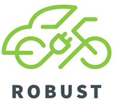

```{r setup, include=FALSE}
library(tufte)
library(ggplot2)
library(tidyverse)
library(sf)
library(viridis)
library(janitor)
library(knitr)
library(kableExtra)

# invalidate cache when the tufte version changes
knitr::opts_chunk$set(cache.extra = packageVersion('tufte'))
options(htmltools.dir.version = FALSE)
```

```{r logo, echo=FALSE, fig.margin = TRUE, out.width="100%"}

 

```


Dear participants of the Galway 29th October co-design workshop, 

Thank you for your time and inputs to the workshop held at ATU Galway last week. We will be reviewing the materials developed in this and other workshops over the next weeks and months, aiming to build on your insights^[...with an aim of helping improve the trial, and research understandings of how shared electric mobility hubs might succeed here in Ireland or elsewhere].  

# My initial takeaways from your comments include:

- Weather^[Especially wind], road safety and other broader issues appear likely to have a large impact on the usage of the e-bikes and e-cargobike at the Galway ROBUST hub.
- Site-specific characteristics of the Galway ROBUST hub's location may also be having a large impact on usage, operations and other issues, especially with respect to: 
  - parking supply^[losses related to construction, changes to the management of nearby privately-controlled parking lots, reductions associated with the hub and nearby charging station, and other factors], 
  - security, safety^[Including lack of sight lines.] and signage; 
  - demographics of the surrounding area, and
  - how the potential of a site based on higher-level or desk-based assessments^[e.g. census statistics, proximity to other facilities / cycling routes / transit, etc.] may not give the full picture of how well it might suit a mobility hub, and that bottom-up approaches may be worthwhile in implementation; and
- There is an interest among workshop participants in better understanding usage of the Galway hub to date. 

# Immediate steps

\smallcaps{Usage data:} Sarbast Moselm^[https://www.tcd.ie/civileng/people/research-staff/moslems/] was at the workshop. He is the Project Manager for ROBUST, and will be following up on the usage data. 

\newthought{Hub incubation?} The ROBUST project includes a Work Package about "Incubation and development of hubs". This is currently in progress, and would seem to be a way to further explore issues related to: 

- weather protection^[Rain covers for the e-bike seats? Shelter? Seating?],
- site activation or similar^[c.f. Jane Jacob's "eyes on the street" \cite{Jacobs:1961aa}], 
- improving connections and engagement with surrounding community facilities and organisations^[e.g. sporting clubs, centres etc.]^[Notably there are already connections (maybe even literally!) to the solar panels, decarbonisation zone etc.], and
- physical changes^[Possibility for improved sight lines and visibility, signage or other enhancements?]


\newthought{Perhaps a way forward might be to set up} an^[informal?] *"Westside Hub and surrounds Working Group"*^[as per pragmatic strategy A3: public processes - \url{https://james-reynolds.github.io/implementation_transit_priority_handout.html}.] or similar?
This might provide a venue for making further progress, connections and deciding on collective actions? Many of the challenges appear to be multi-actor, multi-institution issues, where community involvement and partnership^[There was some discussion about the possibilities of increasing community buy-in, sense of responsibility for and 'ownership' of the hub and/or other elements of the area.] in decision-making might help towards better outcomes. The ROBUST hub isn't necessarily central to (or even involved in) all of the surroundings issues, but it might help provide a (geographic) focus and possible opportunities for progress^[through the hub incubation and development part of the research?].  

\newthought{Finally, there's another video} about the project. Please feel free to share as you see fit.    

```{r letterkennyTransportHub, out.width = "100%", fig.align = "center", fig.cap = "Screenshot from ROBUST animation. Source: https://www.youtube.com/watch?v=HBINvJBJPlU", echo = FALSE, warning=FALSE, message=FALSE, cache=FALSE, fig.fullwidth = FALSE}
 

```
 


\newthought{Otherwise, please feel free to continue the conversation} with us, \underline{perhaps over email for the moment}^[james.reynolds@atu.ie and noreen.armstrong@atu.ie, but, I expect that I will be back down in Galway again from time-to-time, or can come down as suits.]:  
\vspace{0.2cm}
Likewise, I'm more than happy to engage further on other topics; sharing knowledge in both directions is part of what academia is about!^[e.g. Podcasts at: \url{https://getaroundcaboolture.au/s2e12-pp-james-reynolds-on-what-it-really-takes-to-get-kids-riding/} and \url{https://publictransportresearchgroup.info/podcast/}]. Most academics will have an ORCID, a ResearchGate account and/or similar other online presences (I am over at *ORCID* (\url{https://orcid.org/0000-0002-5508-9810}), *Research Gate* (\url{https://www.researchgate.net/profile/James-Reynolds-11}) and *LinkedIn* (\url{http://au.linkedin.com/in/julianjamesreynolds}) amongst other places.). Others from the ROBUST team are similarly on many of the platforms^[A start for each is: *Brian Caulfield*: \url{https://peoplefinder.tcd.ie/Profile?Username=caulfib}; *Amaya Vega*: \url{https://pure.atu.ie/en/persons/amaya-vega-3/}; *Sarbast Moselm*: \url{https://www.tcd.ie/civileng/people/research-staff/moslems/}; *Noreen Armstrong*: \url{https://www.linkedin.com/in/noreenarmstrong/};and *Brian McCann* (teaching in Sligo during the workshop): \url{https://scholar.google.com/citations?user=1YzT21kAAAAJ&hl=en}].    


\vspace{0.2cm}


All the best, and thanks for your inputs to date,

James Reynolds^[email: james.reynolds@atu.ie]


