```{r setup, include=FALSE}
library(tufte)
library(ggplot2)
library(tidyverse)
library(sf)
library(viridis)
library(janitor)
library(knitr)
library(kableExtra)

# invalidate cache when the tufte version changes
knitr::opts_chunk$set(cache.extra = packageVersion('tufte'))
options(htmltools.dir.version = FALSE)
```

```{r logo, echo=FALSE, fig.margin = TRUE, out.width="100%"}

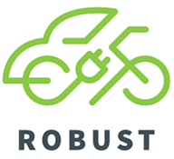 

```

Welcome to a ROBUST co-design workshop. 

The QR code in Figure 1 links 
to an (initial draft) short video on the project, 
and how to use the e-bikes and e-cars at the hub. 

```{r plot_robust_qr_code_to_youtube, include=TRUE, echo=FALSE, fig.margin = TRUE, out.width="100%", fig.cap="Draft mobility hub video at https://www.youtube.com/watch?v=hu9jsgi8CVU"}


```


# What is a shared mobility hub?

"A shared mobility hub is a place where different transport modes are integrated seamlessly, promoting efficient and sustainable urban mobility. Emphasis is given on shared mobility options such as bikes, scooters and cars. Connection with public transport (transit) is desirable but not necessary. The integration between mobility suppliers is important to provide a seamless, flexible connection at these transfer points. Ensuring an enjoyable experience for travelers is a crucial part of the hub concept as well, and therefore the hub should be considered not just as a transfer node but as a place where a variety of services come together, such as logistics services or restaurants."[@Roukouni:2023aa]

# What is the ROBUST shared ELECTRIC mobility hub in Letterkenny?

The Letterkenny ROBUST hub is located 
and includes an 
e-cargo bike, 
four e-bikes
and two shared electric cars. 

```{r plot_hub_photo, eval=TRUE, include=TRUE, echo=FALSE, fig.margin = TRUE, out.width= "95%", fig.cap = "Shared electric cars at the hub"} 

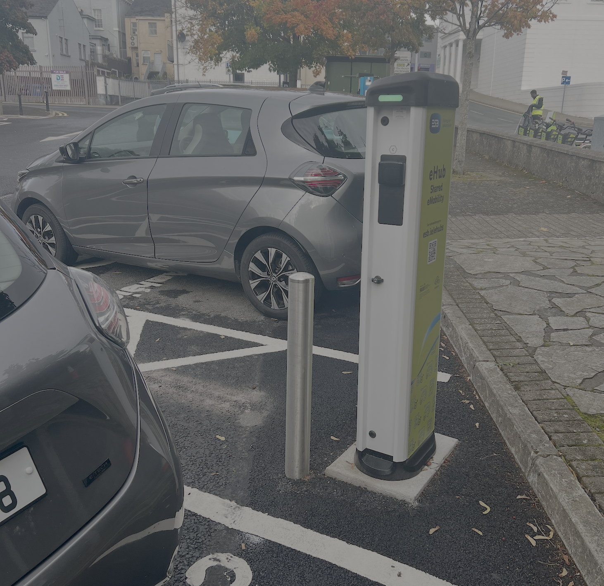


```


```{r plot_hub_photo_bikes, eval=TRUE, include=TRUE, echo=FALSE, fig.margin = TRUE, out.width= "95%", fig.cap = "Shared electric bikes at the hub"} 

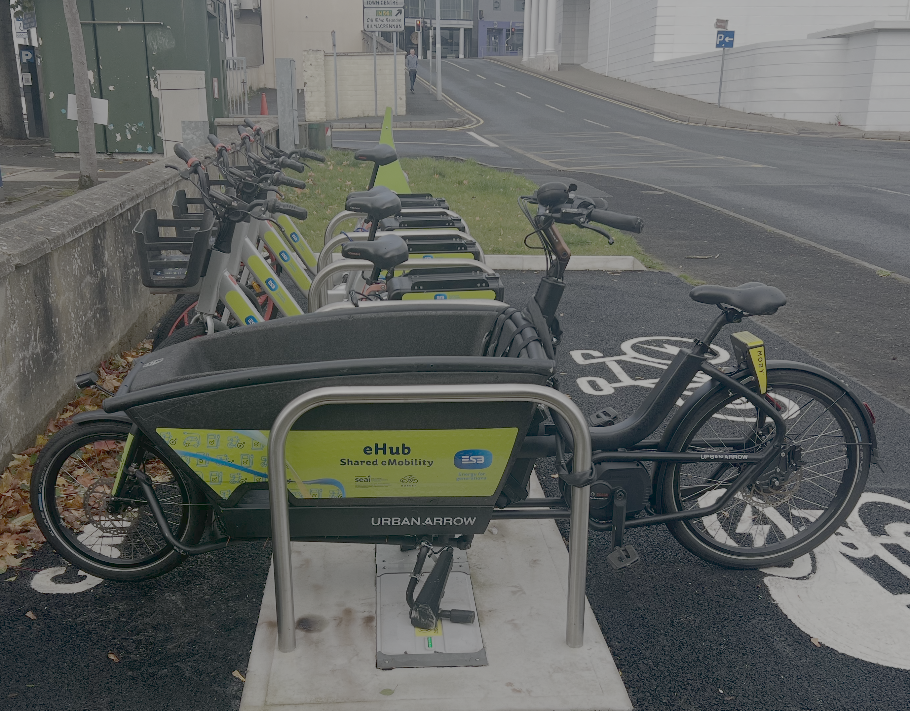


```

Included in the hub is dedicated parking and the
*power infrastructure* to support recharging of these vehicles onsite.  

There is further information on an (initial draft) website, which is accessible via the QR code in Figure 4^[Or at https://james-reynolds.github.io/ROBUST_Electric_shaRed_mOBility_hUbS_Trial_website/].  
\newpage

# What is the PURPOSE of this workshop?


```{r plot_robust_qr_code_to_website, include=TRUE, echo=FALSE, fig.margin = TRUE, out.width="100%", fig.cap="Draft mobility hub website, user facing version"}


```


This workshop seeks to improve research understandings of how best to implement 
shared electric mobility hubs, such as the one being trialled here in Letterkenny. 
At this stage of the research we have *three key questions* that we would like your input on: 

- how does the return-to-origin (A-to-A) restriction impact on users and useability? 
- how can the hub offerings better meet community needs (including through expansion)?
- how can information about the hub and how to use it best be communicated? 


# How does this workshop ACHIEVE its purpose? 

This workshop is guided by the @UK-Design-Council:0aa Double Diamond 
design process (Figure 5). 
It involves iteration through four steps: 
Discovery; Definition (of the problem); Development; Delivery (of a solution). 
The steps alternate between 'divergent' and 'convergent' 
approaches, as well as iteration. 


```{r double_diamond_figure, include=TRUE, echo=FALSE, out.width = "100%", fig.fullwidth = FALSE, fig.cap = "Framework for Innovation. Source : UK Design Council (undated)", crop = TRUE}

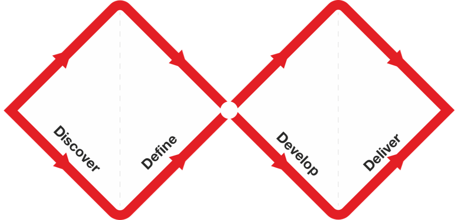

```

First steps: 
  *1. Please read the participant information sheet and sign the consent form.*


\newpage

# Return-to-origin, and other elements
There have been various challenges with some shared micro-mobility systems [@Zhang:2022aa; @Ferguson:2025aa], including: 

- staff may need to drive around to re-position the vehicles, so that there is adequate supply across a network (Figure 6)^[Image cropped.  CC  Attribution-Share Alike 3.0 Unported  license. See https://creativecommons.org/licenses/by-sa/3.0/deed.en] and to swap batteries. 
- fire risks when batteries are charged, and 
- inappropriate parking of dockless bikes, e-bikes and scooters. 

```{r rebalancing, include=TRUE, echo=FALSE, out.width = "100%", fig.margin = TRUE, fig.cap = "Bike share rebalancing. Source: Schwede66 on wikimedia commons", crop = TRUE}

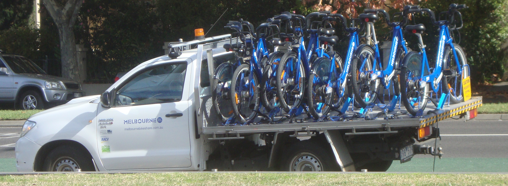

```

The ROBUST system addresses these challenges by having ONE PARKING SPACE per vehicle, and on-site recharging.  However, this means that vehicles HAVE TO BE RETURNED to the hub. This is common for shared cars, but unusual for shared e-bikes. 


## Discovery

Journey mapping can be used to visually show someone travels (see Figure 7)

```{r travel_map, include=TRUE, echo=FALSE, out.width = "100%", fig.fullwidth = FALSE, fig.cap = "Journey mapping James and Noreen's Waterford travels", crop = TRUE}

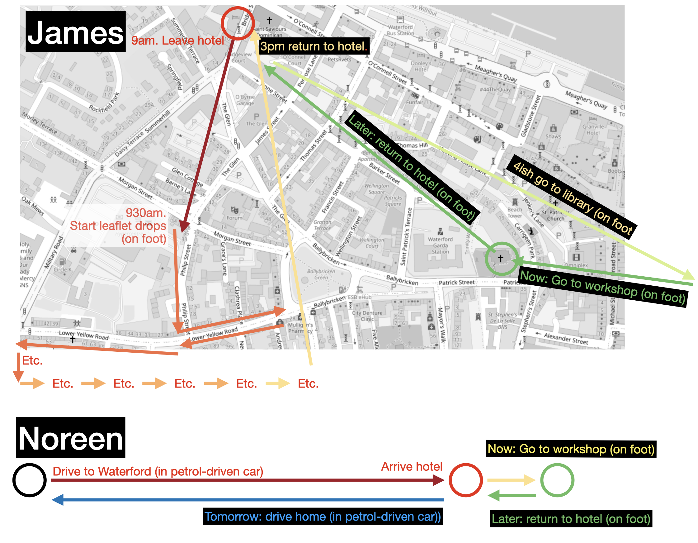

```

*2. Please create some journey maps from your typical travels.* These might include trips: to/from work; for shopping, or social, sporting and other activities; involving travel with someone else (e.g. family member, friends). 


## Definition

*4. For those journeys you have mapped that involve travel in a petrol-driven vehicle* can this be replaced by use of one of the hub vehicles? 
Can other trips or parts of your travel be made easier through use of one of the hub vehicles?
What problems are there for you in (potentially) using the hub vehicles as part of your travel? 
Where possible,  *please redraw you journey maps* to reflect how your travel might look if a mobility hub was part of your trips


```{r travel_map_redrawn, include=TRUE, echo=FALSE, out.width = "100%", fig.fullwidth = FALSE, fig.cap = "Journey mapping James and Noreen's Waterford travels: REDRAWN", crop = TRUE}

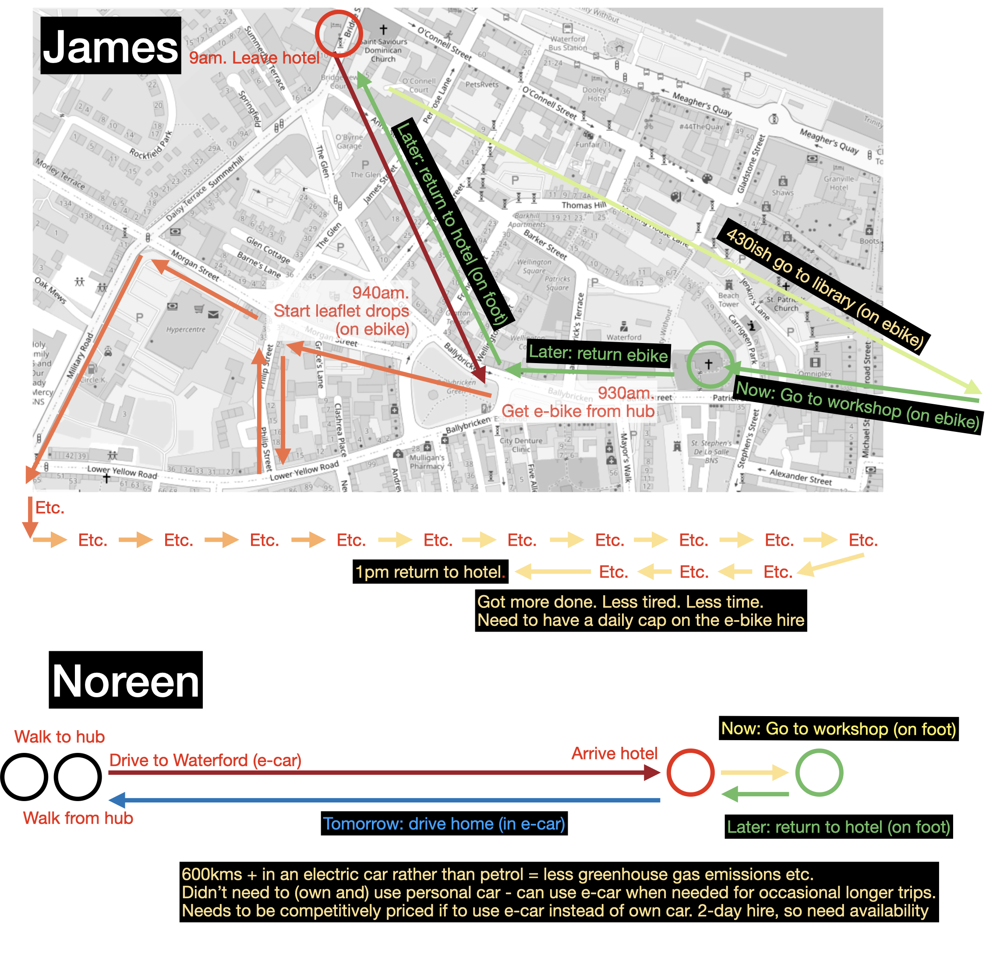

```


\newpage

## Development
@Schemel:2020aa suggests many foundational (Figure 9) and *supporting* (Figure 10) mobility hub elements. Case research undertaken as part of the ROBUST project has also identified hubs that include: USB power supply (for phone charging), wifi and drinking water. 


```{r foundational elements, include=TRUE, echo=FALSE, out.width = "100%", fig.margin = FALSE, fig.cap = "Foundational elements? Source: (ARUP 2020)", crop = TRUE}

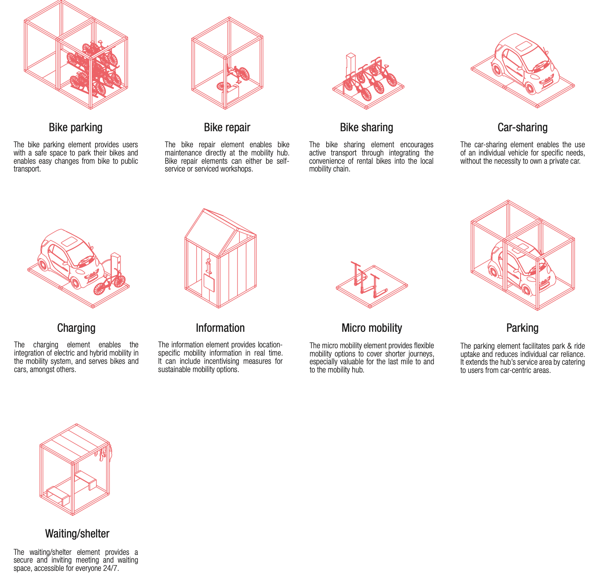

```


```{r supporting elements, include=TRUE, echo=FALSE, out.width = "100%", fig.margin = FALSE, fig.cap = "Supporting elements? Source: (ARUP 2020)", crop = TRUE}

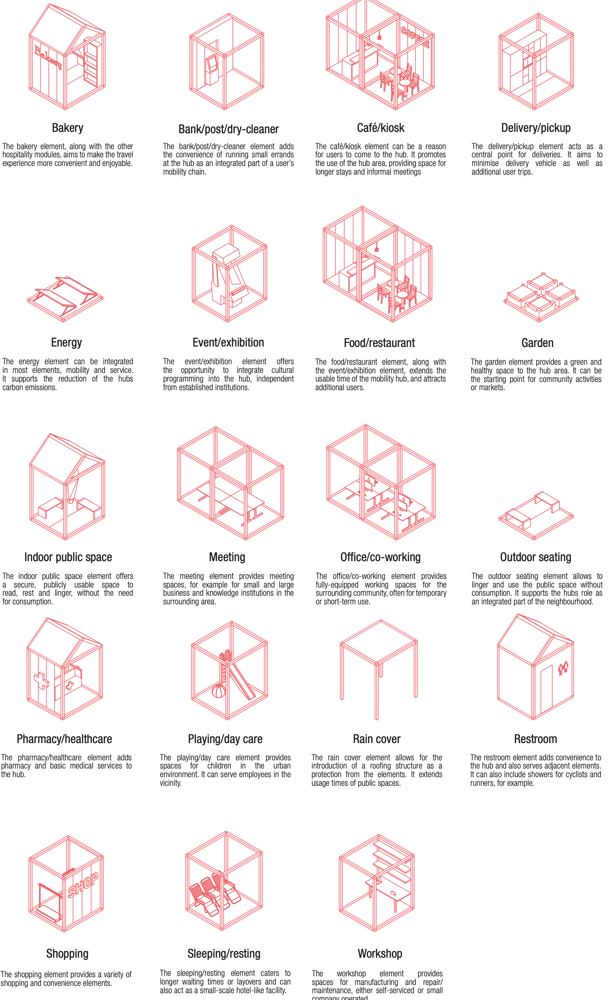

```


Figure 11 shows an example of how various elements might be combined (as per @Schemel:2020aa)


```{r combined_elements, include=TRUE, echo=FALSE, out.width = "100%", fig.margin = FALSE, fig.cap = "Combining elements. Source: (ARUP 2020)", crop = TRUE}

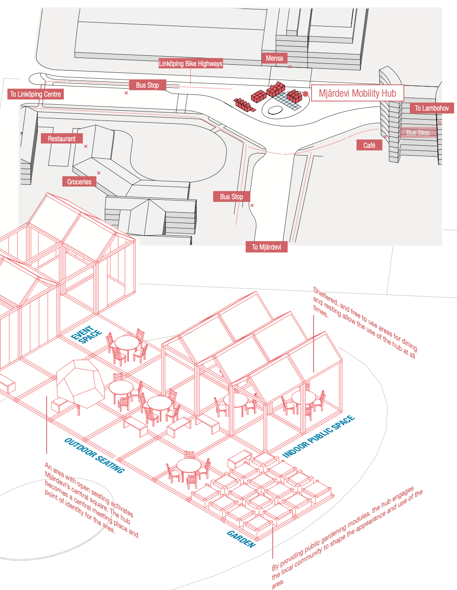

```


- *5. What features could be added or changed* to help resolve the problems you might have in using the ROBUST hub as part of your travel and logistics? 
- What might help to make using a mobility hub *seamless*? 
- What about the vehicles? 
  - (Electric) tricycle or rickshaw? 
  - (Electric) tandem bikes? 
  - (Electric) scooters? 
  - (Electric) vans?
  - ???


## Delivery

Lego models, scaled plans and other materials can all be used as part of co-design processes[@Napper:2021aa]. 

```{r Napper_lego, include=TRUE, echo=FALSE, out.width = "100%", fig.margin = TRUE, fig.cap = "LEGO model usage in research co-designs. Source: Napper et al (2021).", crop = TRUE}

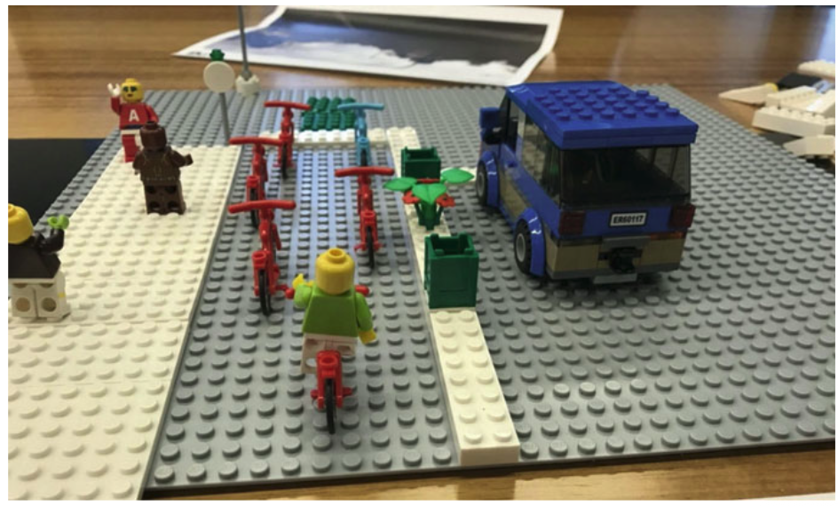

```


*6. What might a shared electric mobility hub that helps to meet you travel and other needs look like*?  

- How should it be accessed? (eg. pricing or subscriptions, use for community groups or businesses or ...?) 
- Who should run it?
- Where should it be located?


\newpage

# Information provision

Part of a mobility hub's job will be to provide *information* to users. 

## Discovery

Case studies in UK have already been examined in this research. Images are shown in Figure 13.


```{r selected_images, out.width = "100%", fig.align = "center", fig.cap = "Selected hub images. Source: authors.", echo = FALSE, warning=FALSE, message=FALSE, cache=FALSE, eval=TRUE}
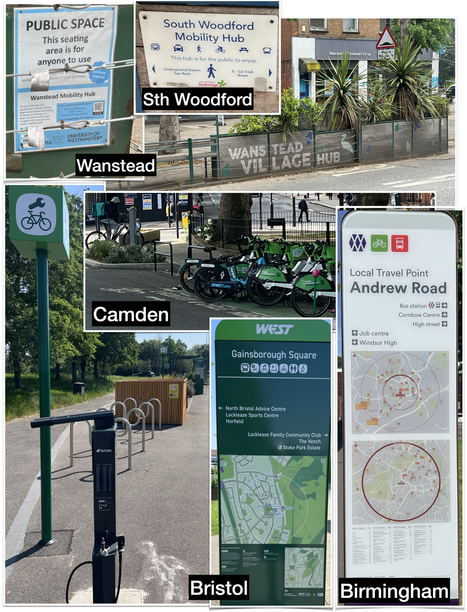 

```

*7. What about the information provided at these mobility hubs* works or does not work for you? What is missing? What might be improved? 

## Definition

*8. What problem should mobility hub information offerings seek to solve?*^[We got: A. What is this? B. Where am I? C. What is here? D. What is nearby? and E. How can I travel from here?] 

What else? What information is more important? 


## Development

Earlier in our research we developed a tool to produce information displays for mobility hubs. Examples of the output are shown in Figure 14, and provided in full-sized format on paper. 

```{r display_outputs_figure, out.width = "100%", fig.align = "center", fig.cap = "Software output: Birmingham (left), Bristol (centre) and synthesis (right) display types. Source: authors.", echo = FALSE, warning=FALSE, message=FALSE, cache=FALSE}
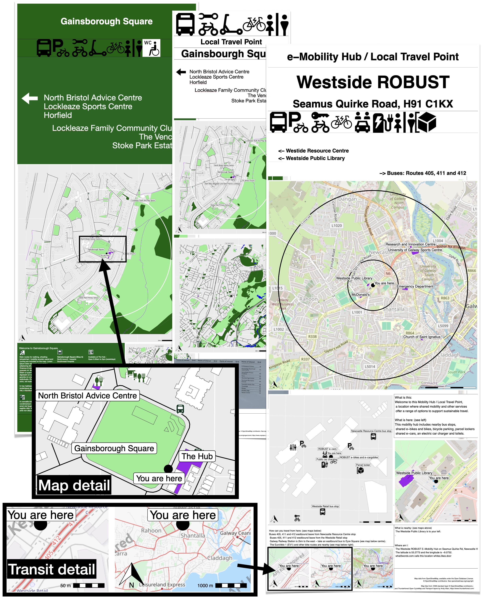 

```

*9. What could be improved about these?*  What else should be shown? 

## Delivery

*10. What would your ideal information provision be like?* Should every mobility hub have a website? What should this look like? Should there be maps, newsletters, events? What else? 

