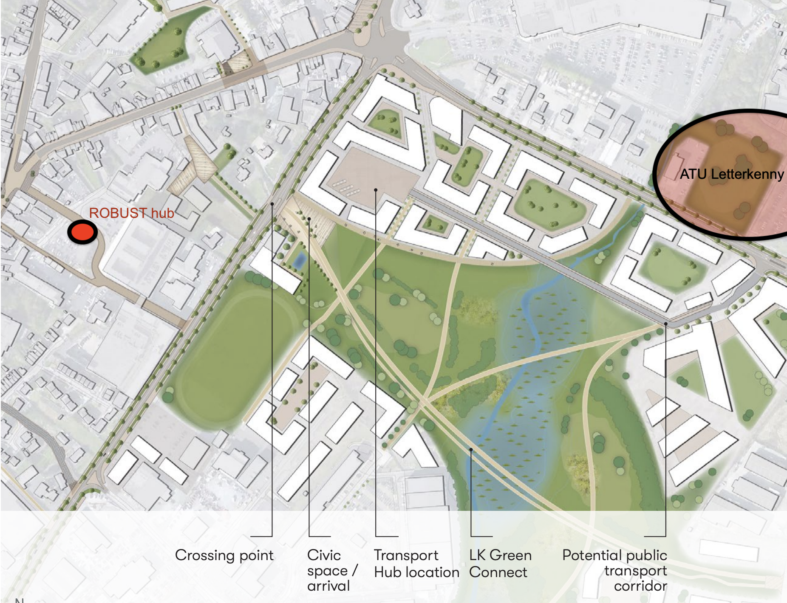
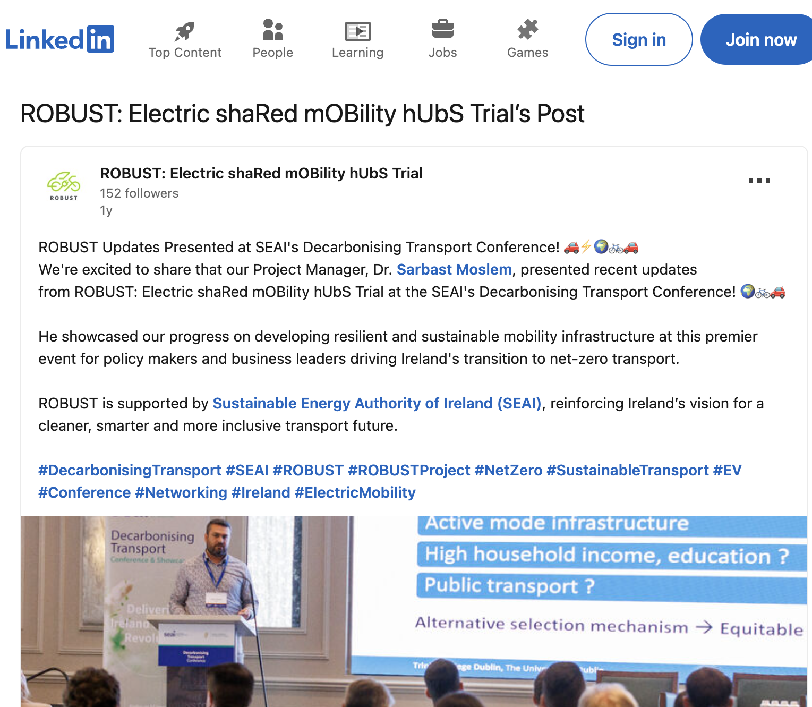

```{r setup, include=FALSE}
library(tufte)
library(ggplot2)
library(tidyverse)
library(sf)
library(viridis)
library(janitor)
library(knitr)
library(kableExtra)

# invalidate cache when the tufte version changes
knitr::opts_chunk$set(cache.extra = packageVersion('tufte'))
options(htmltools.dir.version = FALSE)
```

```{r logo, echo=FALSE, fig.margin = TRUE, out.width="100%"}

knitr::include_graphics("graphics/robust-logo-news.png") 

```


Dear participants of the Letterkenny co-design workshop, 

Thank you for attending and for your inputs to the workshop held at ATU Letterkenny earlier this month. We will be reviewing the materials developed in the workshop over the next weeks and months, aiming to build on your insights^[...with an aim of helping improve the trial, and research understandings of how shared electric mobility hubs might succeed here in Ireland or elsewhere].  

# My initial takeaways from your comments include:

- There is a Letterkenny 2040 Regeneration Strategy^[https://www.letterkenny2040.ie/], which includes a Concept Transport Hub close to the ROBUST hub.

```{r letterkennyTransportHub, out.width = "90%", fig.align = "center", fig.cap = "Letterkenny Transport Hub concept and its proximity to the ROBUST hub and ATU. Source: author's annotations added to LKY 2040 Design Concepts p.10", echo = FALSE, warning=FALSE, message=FALSE, cache=FALSE, fig.margin = FALSE}
 

```


- There may be advantages to offering A-to-B mobility options^[i.e. docked or dockless shared bikes or similar, along the lines of: TFI bikes / 'Boris' bikes / Bolt e-bikes / Lime micro-mobility etc.] in addition to the current A-to-A (return to origin) offers^[e-bikes/e-cargobikes/e-cars].
- The ROBUST hub is not especially close to ATU, residential areas or other places that might benefit especially from a A-to-A model^[i.e. for trips such as home-(foot)-hub-(ebike)-shopping-(ebike)-home-(ebike)-hub-(foot)-home or home-(foot)-campus-then-later-(ebike)-somewhere-else-(ebike)-campus-(foot)-home.] - we also discussed target audiences, how convenient proximity is of high importance for a hub to be useful, and how availability and flexibility are likely to be key factors influencing usage.  

- There is an interest amongst workshop participants in better understanding usage of the Letterkenny hub to date. 

# Immediate steps

\newthought{Usage data:} we briefly discussed data availability, including with Sarbast Moselm^[https://www.tcd.ie/civileng/people/research-staff/moslems/] who is based at Trinity College Dublin (TCD), who is the Project Manager for the ROBUST project^[see https://tinyurl.com/5b9h5rd7], and who attended our workshop.  


```{r display_outputs_figure, out.width = "100%", fig.align = "center", fig.cap = "LinkedIn post from the ROBUST project. Source: LinkedIn", echo = FALSE, warning=FALSE, message=FALSE, cache=FALSE, fig.margin = TRUE}
 

```

Noreen and I have both received various data reports from the ROBUST industry partners. However we have been focused on the co-design workshops and other qualitative data collection. For myself, I have not had chance to delve deeply into the data yet, nor am I certain what can and what cannot be shared^[It is probably in my emails somewhere, just not to hand or in my mind right now, sorry].  I am uncertain if there is currently an analysis or report of the data to date that is in a format that can be easily shared. The joys of research I guess is that there's only so many hours in the day / week / month, and only so many researchers available. I'll get to it soon hopefully, by for the moment I would suggest contacting TCD directly to discuss data access, availability and format^[Otherwise, I can endeavour to find out more when I have capacity available - please let me know if you would like further input from me on this.].


\newthought{Hub inclubation?} The ROBUST project includes a Work Package about "Incubation and development of hubs". This is currently in progress, and would seem to be an appropriate venue to further explore issues related to: 

- the potential for inclusion of A-to-B offers, and
- connections to the ATU campus and (Concept) Transport Hub.  

Perhaps the ROBUST hub might one day be 'part' of the Transport Hub Concept? Maybe a secondary name as the "Transport Hub ROBUST Annex" or something?^[I used to live in downtown Toronto, only a short walk from "The Annex", which became part of the City of Toronto in 1883 (through "annexation" from Yorkville)(https://en.wikipedia.org/wiki/The_Annex). The area remains important in transport planning circles due to Jane Jacobs (famous for https://en.wikipedia.org/wiki/The_Death_and_Life_of_Great_American_Cities and the "eyes on the street" concept of passive urban community building) and the cancellation of the Spadina Expressway https://en.wikipedia.org/wiki/Allen_Road#Spadina_Expressway. My understanding is that to this day the City of Toronto continues to hold a 99-lease on a 1 metre wide strip of land that prevents further southward expansion of the Spadina Expressway into the Annex!]. Please let me know your thoughts!

In the shorter term, I've reached out to some other members of the ROBUST team to see if we can get something happening^[More connections to the ATU campus or other experimental aspects that might be added to the trial].  

\newthought{Further workshops:} We had planned to undertake co-design activities with the general public on 12 October. However, that could not go ahead due to events beyond our control.  We hope to organise further co-design workshops in the future in Letterkenny, including with the general public.  There may be opportunities to return again once the research has progressed further to run further stakeholder workshops too.  In the meantime, please feel free to reach out if you have questions, suggestions or anything else.  An exciting thing about co-design^[And trials! See https://james-reynolds.github.io/implementation_transit_priority_handout.html on trials, pop-ups and legitimising implementation.] is that there is plenty of opportunity for anyone to jump in and contribute to the research! 

All the best, and thanks for your inputs to date

James Reynolds^[email: james.reynolds@atu.ie]


