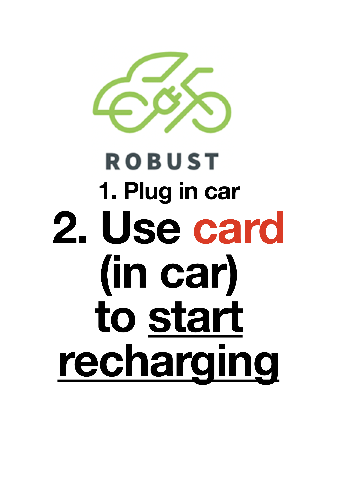
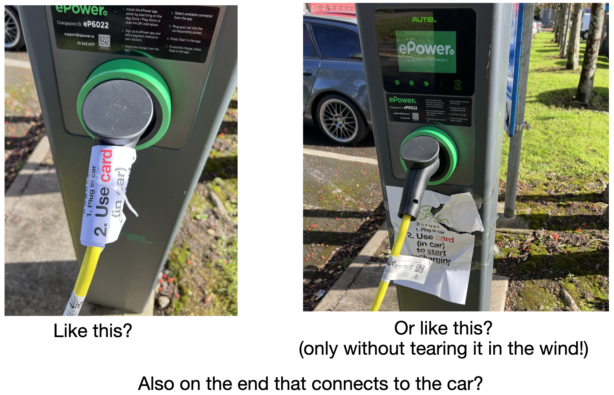
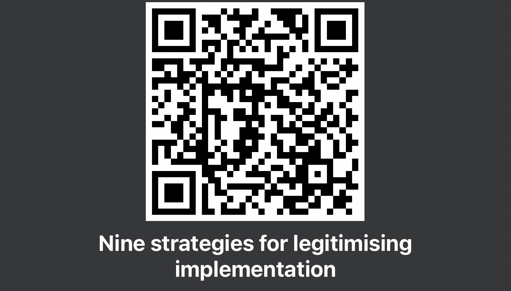
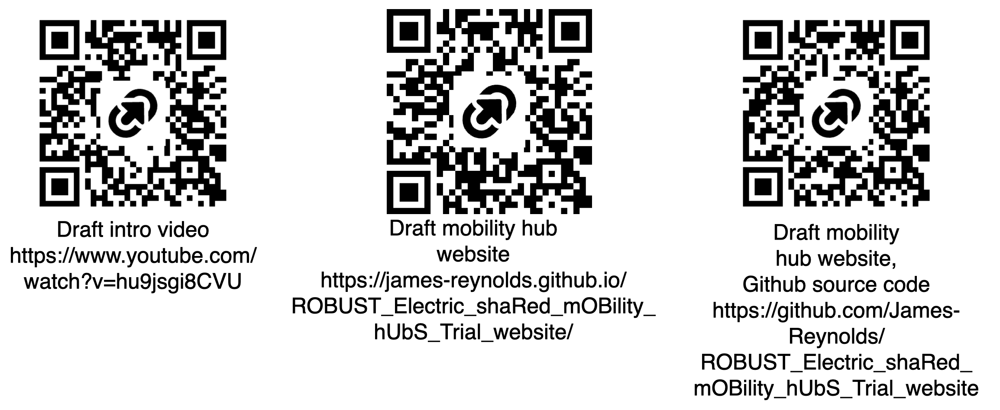
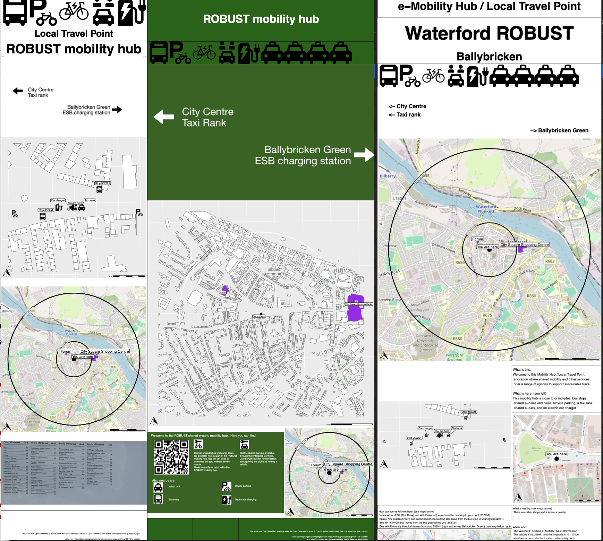

```{r setup, include=FALSE}
library(tufte)
library(ggplot2)
library(tidyverse)
library(sf)
library(viridis)
library(janitor)
library(knitr)
library(kableExtra)

# invalidate cache when the tufte version changes
knitr::opts_chunk$set(cache.extra = packageVersion('tufte'))
options(htmltools.dir.version = FALSE)
```

```{r logo, echo=FALSE, fig.margin = TRUE, out.width="100%"}

knitr::include_graphics("graphics/robust-logo-news.png") 

```


Dear participants of the Waterford co-design workshops^[6 and 7 October], 

Thank you for your inputs at the co-design workshops this week. There was a lot to take in from all of your comments.  We will be looking closely at the materials developed in the workshop over the next weeks and months, with an aim to using your insights to improve the trial and better understand how shared electric mobility hubs might succeed here in Ireland or elsewhere.  

# Initial takeaways 

My initial takeaways from your comments are: 

- there are challenges in using the apps and other aspects of the user interface^[Including for *new users*, for whom separate step-by-step instructions for the e-cars and the e-bikes in multiple formats (especially on-site signage) might help. However, the need to *both plug in and ALSO activate* the car charging with the access card is also an issue - not necessarily obvious to all users who might be expecting plugging in the cars would be enough to start recharging.];
- reliability and availability may be limiting the potential of the hub^[Especially with respect to the cars' batteries running down when plugged in but *not* charging.], but might be improved on with more local and community involvement in the day-to-day management^[Potential for local shops, community members or others to be involved in regularly monitoring the vehicles, taking them for a spin around the block every few days, acting as an immediate contact to help users etc. perhaps in exchange for a reduced rate, free hours, (in the case of shops) free use of cargo bikes for short deliveries / dropping off purchases just made in store, etc. .];
- topography is an important factor for the use of the e-bikes, given the location of the hub at the top of a hill^[Need to walk up the hill to get to the hub, e-bikes not necessarily having the power or sufficient remaining charge to get up hills (when returning to the hub), braking while going downhill (especially for first-time riders).] 
- there may be potential to provide weather protected and well sheltered seating, as there is not much other than the bandstand nearby (and that just has steps).
- there may be potential for a bit of friendly competition between Waterford and the other hubs as far as tracking a leaderboard of 'most trips', 'most carbon saved' or something similar; 
- there may be potential for alternate vehicle types, given the demographics (i.e. older population)^[Electric tricycle? Tandem bike so someone can take someone else with them?] and other characteristics of the surrounding area (i.e. more apartment living and interest in car-free life^[Potential for e-cars, e-vans, additional e-cargobikes], common use of walking and cycling^[Many people already have their own bikes so shorter-range e-bikes may be less useful, but it might be useful to have longer range e-bikes for longer trips.]).


\newpage
# Immediate steps


## Sticker for the car chargers


```{r stickers, include=TRUE, echo=FALSE, fig.margin = TRUE, out.width="100%", fig.cap="First version of sticker for car chargers"}



```

A sticker on the car charger to remind users to start the recharging (using the card inside the car) was suggested as a way to reduce problems with the cars being left plugged in but not 'charging'. I've put together a first version (available at https://github.com/James-Reynolds/WP4_co-creative_workshops/blob/main/graphics/charger_sticker_half_size_261009.png or ...charger_sticker_mock_up_261009.png).  


I've tried it on a (different type of) car charger here in Sligo, and it looks ok as a concept. Maybe it might work on the ROBUST system in Waterford? 

```{r stickers_test, include=TRUE, echo=FALSE, fig.fullwidth = TRUE, out.width="100%", fig.cap="First version of sticker for car chargers - test in Sligo on similar charger"}



```


I'd suggest that all is needed is for \smallcaps{someone who lives nearby} to print out four of these on stickers^[Or get the [Design Print House](https://maps.app.goo.gl/R6qTjiNNpNx3ug7f6) to do it], and \smallcaps{attach one to each end} of each of the charging cables.  


\newpage
## Pop-ups (seating?)


```{r legitimisation, include=TRUE, echo=FALSE, fig.margin = TRUE, out.width="100%", fig.cap="QR code for short 2-pager with details about pop-ups and otherwise legitimising implementation"}



```

We touched on previous research findings about legitimising implementation through pragmatic strategies^[Legitimation *before* implementation (1. Technical evaluation, 2. vision-based plans, 3. public enquiry/decision-making); avoiding impacts (4. grade-separation, 5. additional capacity, 6. subservience); and legitimation *through* implementation (7. bottom-up and incremental, 8. *pop-ups*, 9. formal trials).].

There may be opportunities in the short term to provide additional seating through bottom-up and incremental action.  This might also be experimented with through adopting a pop-up approach to see what might work, what the community might like to have, or even if the community wants anything at all^[Pop-downs are always possible!]. Watch out for that (possibly) happening sometime soon near the hub! 

\vspace{2cm}


## Information - online


As discussed in the workshops, we now have a draft short video on the project and how to use the e-bikes and e-cars.  There's also an initial draft website.  Please let us know if you have any initial thoughts, and stay tuned for further versions.  


```{r plot_robust_qr_code_to_youtube, include=TRUE, echo=FALSE, fig.fullwidth = TRUE, out.width="100%", fig.cap="Draft mobility hub video and website links"}



```
 
 


\newthought{A great thing about co-design research is that *everyone* can take part} in improving the output if they would like too! If you are interested in having a go and making your own videos or other forms of information about the hub please feel free to just go ahead. Drop us a line if you'd like to collaborate or get some help to get started. This is all (just) research and a trial to see what we can make, so nothing has to be perfect...^[...just hopefully better than what we've got so far - "A narrator with an Aussie accent? That's ridiculous! Can someone with an Irish accent send me a different version.  Anyone who speaks Gaelic want to have a go at recording a version?" ]

Likewise, the website is hosted on Github (QR code and link above, right), and uses open source software.  This means that you can edit it yourself and send me a 'pull request' to incorporate your changes. There are further details in the Readme of the github repository, or you can drop me an email or otherwise reach out if you'd like help getting started.   


## Information - physical 

Thanks for the feedback on the research work done to date on developing Mobility Hub informational and directional signs (see Figure 5). The software developed so far is available on github^[https://github.com/James-Reynolds/mobilityHubTools] as well as PDF versions of the Waterford totem / pedestal signs that we had printed out in A0 size at the workshop^[See https://github.com/James-Reynolds/WP4_co-creative_workshops/tree/main/graphics_totems] 


```{r plot_totems, include=TRUE, echo=FALSE, fig.fullwidth = TRUE, out.width="100%", fig.cap="Working draft of Waterford totems as per Bristol (left), Birmingham (centre) and a combined style (right)"}




```


Note of course, that these are rough outlines and just what we have so far.  I'll be looking towards improving these based on your comments in the workshops^[Especially adding information about the topography!], and iterating improved designs. If you like coding and are interest, you can (like the website) download the code, improve it, and send me a pull request to incorporate you improvements. 

Please stay tuned for further details of what I come up with - perhaps we might be able to test some of them in the field and see what people on the street think?      


## More workshops? 

Noreen and I are off to Letterkenny and Galway over the next month or so to run workshops there.  But, neither of us is far away, and we'd certainly be interested in coming back to get your further thoughts an insights as the trial progresses and the iterative co-design processes iterate! 

More generally, I'm happy to come talk or otherwise interact about transport, implementation and policy-making, or pretty much any other related topic, so please let me know if that is of interest.  

All the best, and thanks for your inputs to the research 

James Reynolds^[email: james.reynolds@atu.ie]


